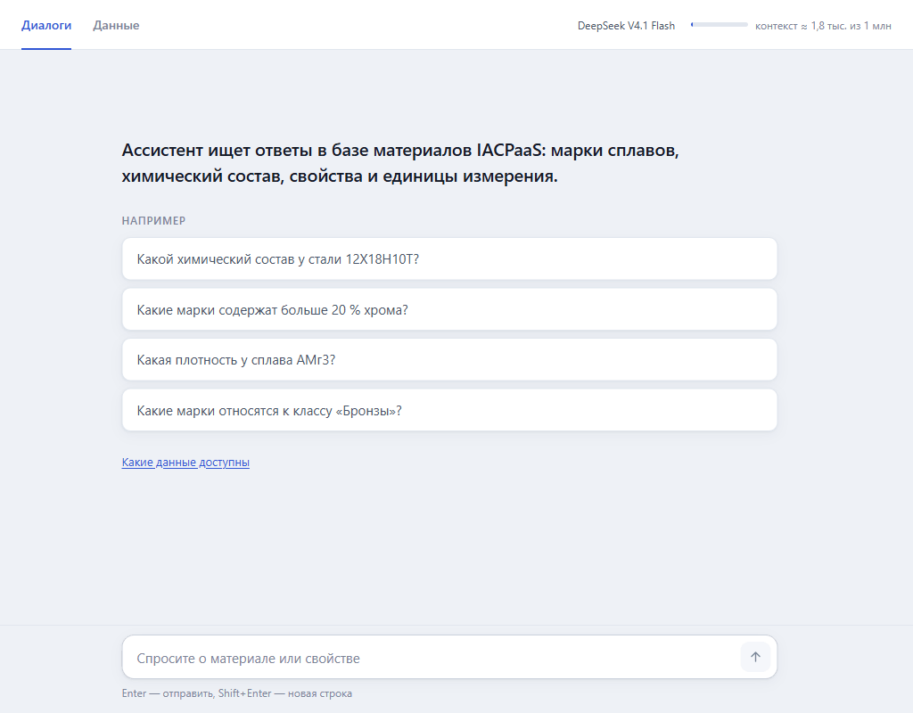

# Чат по базе материалов IACPaaS



Учебное локальное приложение. Пользователь задаёт вопрос в браузере, агент сам решает, нужны ли данные, и вызывает инструменты MCP-сервера, который читает разрешённые ресурсы IACPaaS. По явной просьбе агент создаёт папки и ресурсы в «Моём фонде», переименовывает вершины и удаляет ресурсы — каждую запись пользователь подтверждает кнопкой. Модель — своя на любом сервере с OpenAI-совместимым API (локальном или корпоративном) или облачная через RouterAI. В интерфейсе видны вызовы инструментов с результатами, источник данных (платформа или локальный индекс) и расход: токены и, если она известна, стоимость.

Данные — ресурсы, которые выдал преподаватель (папка «Загрузки», защищена от записи): справочник по материалам, база свойств, база химических элементов, система единиц, терминологический справочник и три онтологии. Что в них лежит — в разделе «Данные» интерфейса и в [docs/data.md](docs/data.md).

## Содержание

1. [Быстрый запуск](#быстрый-запуск) — установка, настройка модели (своей или RouterAI), запуск
2. [Модель: своя или RouterAI](#модель-своя-или-routerai) — требования, окно контекста, цены, порты
3. [Как устроен ответ](#как-устроен-ответ)
4. [Откуда берутся данные](#откуда-берутся-данные)
5. [Запись в IACPaaS](#запись-в-iacpaas)
6. [Подбор марок по составу](#подбор-марок-по-составу)
7. [Проверка ответов](#проверка-ответов)
8. [Расход и история диалога](#расход-и-история-диалога)
9. [Как использовать MCP-сервер](#как-использовать-mcp-сервер) — веб-чат, VS Code, любой MCP-клиент
10. [Docker](#docker)
11. [Тесты](#тесты)
12. [Что где находится](#что-где-находится)
13. [Если что-то не работает](#если-что-то-не-работает)

## Быстрый запуск

Нужны Python 3.11 или новее (проверено на 3.12), доступ в интернет к IACPaaS и модель: своя на любом сервере с OpenAI-совместимым API или RouterAI. Команды выполняются из корня проекта.

**1. Установка.**

```powershell
python -m venv .venv
.\.venv\Scripts\python.exe -m pip install -r requirements-lock.txt
.\.venv\Scripts\python.exe -m pip install --no-deps -e .
```

`requirements-lock.txt` — проверенные версии пакетов: агент расширяет внутренние методы `ChatOpenAI`, и новая версия `langchain-openai` может это сломать.

**2. Настройки.** Скопируйте `.env.example` в `.env`, впишите учётные данные IACPaaS и заполните один из двух блоков модели. Правило выбора одно: если `LLM_BASE_URL` заполнен, работает своя модель, а блок RouterAI не используется; если пуст — RouterAI.

```dotenv
IACPAAS_USERNAME=ваш_логин
IACPAAS_PASSWORD=ваш_пароль

# Своя модель: LM Studio, Ollama, vLLM, корпоративный шлюз — любой сервер с OpenAI-совместимым API
LLM_BASE_URL=http://адрес-сервера:порт/v1
LLM_MODEL=имя_модели_на_сервере
LLM_API_KEY=ключ_если_нужен

# Или RouterAI — используется, когда LLM_BASE_URL пуст
ROUTERAI_API_KEY=ваш_ключ
ROUTERAI_MODEL=deepseek/deepseek-v4.1-flash
```

| Поле | Что вписать |
|---|---|
| `LLM_BASE_URL` | Адрес API — тот же, что `base_url` у клиента OpenAI, обычно оканчивается на `/v1`. Например: LM Studio — `http://127.0.0.1:1234/v1`, Ollama — `http://127.0.0.1:11434/v1` |
| `LLM_MODEL` | Имя модели точно как `id` в ответе `GET <LLM_BASE_URL>/models` |
| `LLM_API_KEY` | Ключ, если сервер его требует (уходит в заголовке `Authorization: Bearer …`); иначе — пусто |

Модель должна поддерживать вызов инструментов (tool calling), окно контекста — не меньше 16 384 токенов. Локальный сервер запустите и загрузите на нём модель до запуска приложения: окно контекста приложение узнаёт при старте. Медленной модели добавьте `MODEL_TIMEOUT_SECONDS=600`. Чтобы сменить модель, поправьте блок в `.env` и перезапустите приложение. Подробнее — раздел [«Модель: своя или RouterAI»](#модель-своя-или-routerai).

`.env` содержит секреты и исключён из Git; не прикладывайте его к отчёту.

**3. Запуск.**

```powershell
.\.venv\Scripts\python.exe -m materials_chat
```

В терминале видно, какая модель подхватилась, например «Модель: qwen3-4b-instruct-2507 — http://127.0.0.1:1234/v1 (своя модель, LLM_*)». Откройте [локальный чат](http://127.0.0.1:8000): в шапке — сервер и имя модели, в подсказке к нему — адрес сервера, цены и окно контекста. Команда поднимает веб-приложение и MCP-сервер; при первом запуске ресурсы загружаются из IACPaaS и строится локальный поисковый индекс. Остановка — `Ctrl+C`.

В PyCharm это конфигурация запуска Python в режиме **module** (не script): модуль `materials_chat`, рабочая папка — корень проекта, интерпретатор — `.venv`. С параметром `sync` команда обновляет индекс.

## Модель: своя или RouterAI

Подходит любая модель на сервере с протоколом OpenAI Chat Completions; код под конкретную модель или сервер не подстроен. Какой блок `.env` работает и какие поля в нём — в «Быстром запуске».

- **Требования.** Вызов инструментов (tool calling) обязателен: агент переключает `tool_choice` между `auto` и `none`, проверяющий требует отчёт с `required`. Окно — не меньше 16 384 токенов, лучше 32 768: запрос агента занимает около 6,6 тысячи токенов ещё до вопроса, с прочитанной записью марки — 13–15 тысяч. Из небольших моделей подходят Qwen3 и Qwen3-2507 Instruct (4B и больше), Qwen2.5 Instruct (7B и больше), Llama 3.1 Instruct 8B, Mistral Small.
- **Ключ.** RouterAI без ключа не работает. Своему серверу `LLM_API_KEY` передаётся, если задан, — и в запросы к модели, и в запрос каталога `/models`; без него клиент отправляет заглушку.
- **Локальный сервер** — адрес на этом компьютере или в локальной сети: `localhost`, `127.0.0.1`, `::1`, частные сети, `host.docker.internal`, имена `*.local` и имена без точки. Для него в шапке — «Локальная модель», вместо стоимости — токены, после тайм-аута запрос не повторяется, а в сообщении об ошибке виден текст ответа сервера. Задать явно — `MODEL_LOCAL=true` или `false`.
- **Окно контекста**: `MODEL_CONTEXT_TOKENS`, если задано; иначе из каталога сервера (`GET <адрес>/models`); иначе окно, с которым модель загружена в LM Studio; иначе 32 768. Откуда взято окно, видно в подсказке к имени модели. Ollama по умолчанию держит окно в несколько тысяч токенов и длинный запрос обрезает молча: задайте окно на сервере (`OLLAMA_CONTEXT_LENGTH`) и то же число в `MODEL_CONTEXT_TOKENS`.
- **Цены** — из каталога сервера (у RouterAI — в рублях) или из `.env`: `PRICE_INPUT_PER_MILLION`, `PRICE_OUTPUT_PER_MILLION`, `PRICE_CURRENCY`. Если цен нет и сервер не присылает сумму, вместо стоимости показываются токены.
- **Время ответа** одного обращения — `MODEL_TIMEOUT_SECONDS` (по умолчанию 120 секунд). Локальная модель на процессоре или встроенной видеокарте отвечает в разы медленнее облачной: для неё 300–600.
- **Порты и Docker.** Приложение занимает порты 8000 (веб) и 8001 (MCP). Если сервер модели слушает тот же порт (у vLLM по умолчанию 8000), смените порт одного из них (`APP_PORT`, `MCP_PORT` и `MCP_URL`). В Docker `127.0.0.1` — сам контейнер: для сервера модели на этом компьютере укажите `http://host.docker.internal:<порт>/v1`.
- **Другие настройки.** Модель RouterAI — `ROUTERAI_MODEL`, имя как `id` в каталоге `GET https://routerai.ru/api/v1/models` (ключ не нужен). Другой облачный провайдер с таким же API (например, OpenRouter) подключается блоком `LLM_*`. Проверяющему можно дать отдельную модель на том же сервере — `VERIFIER_MODEL`. Температура — `MODEL_TEMPERATURE` (по умолчанию 0: меньше разброс между одинаковыми вопросами).
- **Небольшие модели** чаще ошибаются в выборе инструмента и аргументах. Проще всего им вопросы, где считает сервер (подбор по составу, подсчёт): один вызов вместо цепочки поисков. Рассуждения `<think>…</think>` в ответ и историю не попадают. Промпт и сценарии отлажены на `deepseek/deepseek-v4.1-flash`; после смены модели стоит прогнать [сценарии демонстрации](docs/scenarios.md). На локальной модели проверено подключение к LM Studio, ответы на вопросы проекта не прогонялись ([docs/verification.md](docs/verification.md)).

## Как устроен ответ

Агент построен на LangChain: `create_agent` собирает граф «модель → инструменты → модель», инструменты MCP-сервера подключаются через `langchain-mcp-adapters`, модель — `ChatOpenAI` с адресом выбранного сервера. Подробности — в [архитектуре](docs/architecture.md#как-работает-агент).

1. Модель получает вопрос, историю диалога и описания MCP-инструментов и **сама решает**, нужны ли данные.
2. На приветствие, вопрос о самом диалоге или просьбу показать уже найденное она отвечает сразу; на вопрос не по теме базы вежливо отказывает.
3. На вопрос о материалах она ищет (`search_graph`) и читает найденную вершину (`get_subgraph`), при необходимости несколько раз.
4. Вопросы по химическому составу («хрома больше 20 %», «топ-3 по хрому», «есть хром, нет никеля») идут через `find_materials`: подбор считает сервер по всем маркам индекса. Вопросы «сколько свойств / элементов / классов» — через `count_graph` с понятием онтологии.
5. Если лимит шагов исчерпан, модель отвечает по уже найденному: на последнем шаге инструменты отключаются.

**Воспроизводимость.** Количество и списки считает сервер, а не модель: «сколько марок, где железа больше 5 %» — точный `total` (1 026) одним вызовом `find_materials`, «сколько свойств в базе» — 28 через `count_graph`. Температура модели — 0; повторный одинаковый вызов в одном ходе не выполняется (`REPEATED_CALL`). Промпт запрещает подставлять факты из памяти модели: ответ без инструментов помечен «без обращения к базе», а аргументы и результаты каждого вызова раскрываются в журнале.

## Откуда берутся данные

У HTTP API IACPaaS есть выгрузка ресурса или его фрагмента, но нет поиска по тексту. Поэтому источник гибридный:

| Инструмент | Откуда данные |
|---|---|
| `search_graph` | Локальный SQLite-индекс — копия ресурсов, загруженная с платформы |
| `find_materials` | Локальный индекс: таблица состава марок, построенная при загрузке ресурсов |
| `get_subgraph`, `get_inforesource` | **Живой запрос к IACPaaS**: `GET /api/data/export/user-item` с `start-target-concept-path` и `export-depth` |
| `count_graph`, `validate_resource`, `list_inforesources` | Индекс и конфигурация |
| `get_subgraph`, `get_inforesource` с `path` | Любой ресурс «Моего фонда» по пути — только живой запрос к IACPaaS |
| `write_inforesource`, `delete_inforesource` | Запись в IACPaaS (раздел «Запись в IACPaaS») |

Если платформа недоступна, базовый ресурс читается из индекса с пометкой «индекс — платформа недоступна», а чтение по `path` возвращает ошибку. Фрагменты больше 5000 вершин читаются из индекса (`LIVE_MAX_NODES`). Подробнее — [docs/api-mapping.md](docs/api-mapping.md).

**Свежесть индекса.** При запуске пустой индекс загружается целиком, а готовый сверяется с платформой по дате изменения каждого из восьми ресурсов: изменившиеся загружаются заново, остальные не трогаются. Сверка идёт в фоне (около 35 секунд), приложение сразу работает по сохранённому индексу; итог виден в разделе «Данные». Полное обновление — кнопка «Обновить из IACPaaS» там же или команда:

```powershell
.\.venv\Scripts\python.exe -m materials_chat sync
```

Список ресурсов — `config/resources.json`, описание данных для интерфейса — `config/data_notes.json`. Для другой предметной области меняют эти файлы и выполняют синхронизацию.

## Запись в IACPaaS

Два записывающих инструмента: `write_inforesource` (`create_folder` — папка, `create_resource` — ресурс по одной из трёх онтологий проекта, `update_concept` — новое имя, значение или комментарий вершины) и `delete_inforesource` (в корзину или безвозвратно). Пример — сценарий 5 в [docs/scenarios.md](docs/scenarios.md).

- **JSON платформы собирает сервер.** Модель описывает ресурс деревом «понятие онтологии + имя или значение»; сервер проверяет его по онтологии из индекса и при ошибке отказывает с подсказкой. Проверить дерево без записи — `validate_resource`.
- **Где можно писать** — в «Моём фонде», кроме восьми базовых ресурсов, папки «Загрузки» и `PROTECTED_PATHS`: туда запись отклоняется (`PROTECTED_RESOURCE`) ещё до подтверждения.
- **Подтверждение.** Перед каждой записью сервер запрашивает подтверждение через MCP elicitation; в чате появляется карточка «Подтвердить / Отменить» с отсчётом 120 секунд. Отмена, истекшее время, «Стоп» или клиент без elicitation — запись не выполняется. Сама модель подтвердить запись не может.
- **Чтение по пути.** `get_inforesource` и `get_subgraph` с `path` («Демо агента / Мои свойства») читают ресурс прямо с платформы. Листинга папок в API нет: путь агент узнаёт от пользователя или из своей записи.
- **Изменение вершины — переимпортом:** метод платформы `PUT /api/data/update` не работает, поэтому сервер выгружает ресурс, меняет вершину и импортирует ресурс заново; при сбое возвращает исходную версию.
- **Не поддерживается:** добавление вершин в существующий ресурс, ссылки и клоны вершин других ресурсов, удаление и переименование папок, копирование фрагментов, удаление подграфов.

Настройки: `WRITE_ENABLED` (`false` — только чтение), `PROTECTED_PATHS` (ещё защищённые пути через `;`), `WRITE_CONFIRM_TIMEOUT_SECONDS` (120).

## Подбор марок по составу

`find_materials` принимает условия на содержание элементов, класс материалов, сортировку и страницу и считает по всем маркам справочника (1 334) в локальном индексе. Результат — `total` (сколько марок подходит), страница марок (`limit` до 50, продолжение — `next_offset`) и дата снимка.

- **Содержание элемента — диапазон.** «17–19 %» — [17, 19]; «не более 0,5» — [0; 0,5]; «не менее 2» — [2; 100]; «расчётное» и запись без значения — диапазон неизвестен.
- **Основа сплава — остаток до 100 %.** Основа (чаще всего железо) записана как «не более X»; её нижняя граница — 100 % минус верхние границы остальных элементов. Так «железа больше 5 %» находит 1 026 марок, а не только 21 марку с явным интервалом.
- **Сравнение только гарантированное.** «Больше X» — нижняя граница больше X, «меньше X» — верхняя меньше X: «Cr > 20» не вернёт марку с хромом 17–19 %.
- **Элемент не указан** — марка по умолчанию не проходит «меньше X» (отсутствие в записи не значит 0 %); флаг `include_unlisted` добавляет такие марки с пометкой.
- **«Есть элемент»** — элемент перечислен в составе в любой форме; гарантированное присутствие — условие «> 0». Элемент, которого нет ни в одном составе, отмечается в `elements_not_in_compositions`.
- **Рейтинг** (`sort_by`) — по нижней границе, при равенстве — по верхней; пределы примесей «не более X» оказываются внизу.
- Условия соединяются через «И»; для «или» модель делает несколько вызовов. Условия по свойствам не поддерживаются.

## Проверка ответов

Два слоя: сверка чисел работает сама и ничего не стоит, проверяющий запускается кнопкой «Проверить».

**Сверка чисел** — после каждого хода (`materials_chat/answer_check.py`): каждое число ответа ищется в данных, которые инструменты вернули в этом диалоге. Не проверяются числа из вопроса и из аргументов удачных вызовов, даты, номера пунктов и строк. Под ответом — «Числа сверены с данными: N из N» или «Не найдены в данных: … — проверьте», такие числа подсвечены.

**Кнопка «Проверить»** запускает проверяющего (`materials_chat/verifier.py`) — отдельное обращение к модели без инструментов. Он разбивает ответ на утверждения о данных и по каждому выносит «подтверждено», «нет в данных» или «противоречит данным» с опорой на вершину (`node_id`) и цитатой из ответа; нажатие на цитату подсвечивает её в тексте. Утверждения появляются по мере готовности. Итог — «Подтверждено X из Y утверждений (Z %)» и вердикт: 100 % — «подтверждён», от 70 % — «частично подтверждён», иначе «не подтверждён». Проверяющий судит только по данным удачных вызовов этого диалога; без них проверка не запускается. Его модель — `VERIFIER_MODEL` (по умолчанию модель агента), расход проверки входит в расход диалога.

Чего проверки не ловят:

- Сверка чисел подтверждает, что число есть в данных, но не что оно относится к нужной марке или элементу; привязку оценивает проверяющий.
- По умолчанию проверяющий — та же модель, что написала ответ; для независимой проверки задайте другую в `VERIFIER_MODEL`.
- Вердикт — оценка модели, а не доказательство; опора (`node_id` и цитата) позволяет перепроверить утверждение вручную.

## Расход и история диалога

- **Расход** виден под каждым ответом и за весь диалог (в шапке и в списке диалогов): токены и стоимость. У RouterAI стоимость — фактическое списание из ответа (`usage.cost`, в рублях), без него — расчёт по прайсу каталога. У локальной модели и модели без цен вместо стоимости показываются токены; «0,00 ₽» без данных не показывается.
- **Контекст** — индикатор в шапке: сколько токенов уйдёт в модель со следующим вопросом из доступного окна. Нажатие открывает панель «Что видит модель» — историю ровно в том виде, в каком она уйдёт в модель.
- **История** хранится в SQLite (`data/history.sqlite3`): у каждого ответа — текст, журнал инструментов с полными результатами, расход, сверка чисел, вердикт проверки и точная цепочка сообщений для модели. В модель история уходит сжатой механически, без пересказа: последние 2 хода полностью (`HISTORY_FULL_TURNS`), у старых результаты инструментов длиннее 1500 символов обрезаются (`HISTORY_TOOL_CHARS`). Поэтому уточнение «а сколько в ней никеля?» работает без нового поиска, а за подробностями модель снова вызывает инструмент. Пересказ моделью не используется: это лишний вызов, который может исказить числа.
- **Если история не помещается** в окно модели (за вычетом места под ответ или мягкого лимита `MAX_CONTEXT_TOKENS`), ход останавливается с предложением начать новый диалог. Между диалогами памяти нет.

## Как использовать MCP-сервер

Данные IACPaaS агенту отдаёт один MCP-сервер (`materials_chat/mcp_server.py`, девять инструментов). Пользоваться им можно тремя способами:

| Способ | Что запустить | Что получится | Что нужно |
|---|---|---|---|
| **Веб-чат проекта** | `.\.venv\Scripts\python.exe -m materials_chat` | Чат в браузере (http://127.0.0.1:8000): агент из этого проекта ходит в MCP-сервер по Streamable HTTP; журнал вызовов, расход, сверка чисел, кнопка «Проверить», подтверждение записи карточкой | `.venv`, `.env` с учётными данными IACPaaS и моделью. Индекс строится сам при первом запуске |
| **Агент в чате VS Code** | Открыть папку проекта в VS Code, в чате выбрать агента «IACPaaS Материалы» | VS Code сам запускает MCP-сервер по `.vscode/mcp.json` (stdio); отвечает модель Copilot, пользуясь только инструментами сервера; запись подтверждается диалогом VS Code | VS Code с Copilot, `.venv`, построенный индекс, `.env` с учётными данными IACPaaS (модель в `.env` не нужна) |
| **Любой MCP-клиент** | Claude Desktop, Cursor и другие — описание сервера в `mcpServers`; MCP Inspector — проверка сервера без агента | Те же инструменты в чужом агенте или в окне отладки | `.venv`, построенный индекс, `.env` с учётными данными IACPaaS |

Индекс сам MCP-сервер не строит: его строит веб-приложение при первом запуске или команда `python -m materials_chat sync`. Без индекса инструменты отвечают `INDEX_NOT_READY`.

### Веб-чат проекта

Запуск — в разделе «Быстрый запуск». Команда поднимает MCP-сервер на `http://127.0.0.1:8001/mcp` (`MCP_URL`) и веб-приложение на `http://127.0.0.1:8000`. Чтобы подключить веб-чат к уже запущенному отдельно MCP-серверу, добавьте `--web-only`.

### VS Code

В проекте есть конфигурация MCP-сервера для рабочей папки (`.vscode/mcp.json`) и свой агент для чата VS Code (`.github/agents/iacpaas-materials.agent.md`). Нужны VS Code с чатом Copilot в режиме агента и `.venv` с построенным индексом; в `.env` достаточно учётных данных IACPaaS — модель здесь берётся из Copilot.

`iacpaas-materials.agent.md` — не GitHub Actions: это файл своего агента (custom agent) для чата VS Code. В шапке — имя «IACPaaS Материалы» и `tools: ['iacpaas/*']`: агенту доступны только инструменты MCP-сервера, файлы, терминал и интернет — нет. Ниже — инструкция: роль, инструменты, правила (отвечать только по данным, подсчёт и подбор — через сервер, запись — только по просьбе и с подтверждением), формат ответа. Агент работает локально: серверу нужны `.venv`, индекс и `.env`, которых в репозитории нет.

1. Откройте папку проекта в VS Code (`code .`). При первом запуске сервера `iacpaas` подтвердите доверие к нему.
2. Откройте чат и выберите агента «IACPaaS Материалы».
3. Спросите, например: «Сколько марок, где железа больше 5 %?» или «Какой химический состав у стали 12Х18Н10Т?». Запись VS Code подтверждает своим диалогом: «Принять» — запись выполняется, «Отклонить» — нет.

`mcp.json` запускает сервер по stdio: `${workspaceFolder}/.venv/Scripts/python.exe -m materials_chat.mcp_server --transport stdio` с `PYTHONIOENCODING=utf-8`. К уже запущенному серверу веб-приложения можно подключиться и по HTTP: `{"type": "http", "url": "http://127.0.0.1:8001/mcp"}`.

**Диагностика:** палитра команд → «MCP: List Servers» → `iacpaas` → «Show Output» (там же строки «Запись IACPaaS: …» о каждой попытке записи).

| Симптом | Причина и что сделать |
|---|---|
| Сервер не стартует, в журнале «No such file» | Нет `.venv` или он в другом месте — установка из «Быстрого запуска» либо поправить `command` в `mcp.json` |
| `ModuleNotFoundError: materials_chat` | Пакет не установлен в `.venv`: `pip install --no-deps -e .` |
| `UnicodeEncodeError` в журнале | Не задан `PYTHONIOENCODING=utf-8` (в `mcp.json` он есть; нужен при запуске вручную) |
| Инструменты отвечают `INDEX_NOT_READY` | Индекс не построен: `python -m materials_chat sync` или один запуск веб-приложения |
| Агент не видит инструментов | Сервер не запущен или выключен в «Configure Tools» чата |
| Запись отвечает `CONFIRMATION_UNAVAILABLE` | Клиент не поддерживает elicitation (в VS Code — с версии 1.102) |

### Любой MCP-клиент

Сервер подключается к любому агенту, который умеет MCP по stdio или Streamable HTTP: Claude Code, Claude Desktop, Cursor, MCP Inspector, OpenAI Agents SDK, LangChain. Оба транспорта используют одну доменную логику:

```powershell
# Локальный процесс: сообщения MCP идут по stdin/stdout.
.\.venv\Scripts\python.exe -m materials_chat.mcp_server --transport stdio

# HTTP: endpoint http://127.0.0.1:8001/mcp
.\.venv\Scripts\python.exe -m materials_chat.mcp_server --transport streamable-http --host 127.0.0.1 --port 8001
```

Пока работает веб-приложение, его MCP-сервер уже доступен по `http://127.0.0.1:8001/mcp`; отдельный HTTP-сервер в это время запускайте на другом порту. Клиенту, который сам запускает сервер по stdio (формат `mcpServers` у Claude Desktop и Cursor), достаточно указать интерпретатор из `.venv`:

```json
{
  "mcpServers": {
    "iacpaas-materials": {
      "command": "C:\\путь\\к\\проекту\\.venv\\Scripts\\python.exe",
      "args": ["-m", "materials_chat.mcp_server", "--transport", "stdio"],
      "env": {"PYTHONIOENCODING": "utf-8"}
    }
  }
}
```

Рабочая папка клиента не важна: `.env`, индекс и список ресурсов сервер находит в корне проекта.

**Проверка сервера без агента — MCP Inspector** (нужен Node.js). Сервер запускается по HTTP (команда выше или веб-приложение):

```powershell
# Окно в браузере: Transport Type — Streamable HTTP, URL — http://127.0.0.1:8001/mcp, Connect → Tools → List Tools.
npx @modelcontextprotocol/inspector

# То же из терминала: список инструментов и один вызов.
npx @modelcontextprotocol/inspector --cli http://127.0.0.1:8001/mcp --transport http --method tools/list
npx @modelcontextprotocol/inspector --cli http://127.0.0.1:8001/mcp --transport http --method tools/call --tool-name count_graph --tool-arg resource_id=properties --tool-arg concept=Свойство
```

**Что получает любой клиент** — это обеспечивает сервер: поиск и подсчёт только по ресурсам из `config/resources.json` (`UNKNOWN_RESOURCE`); чтение ресурса «Моего фонда» по пути; защиту базовых ресурсов и «Загрузок» от записи; подтверждение каждой записи через MCP elicitation (клиент без него писать не может — `CONFIRMATION_UNAVAILABLE`); лимиты глубины, размера и страниц (`LIMIT_EXCEEDED`); ошибки как результат с кодом; источник данных (`served_from`, дата снимка) в каждом результате.

**Что остаётся в веб-чате** — это часть агента: правила промпта (`materials_chat/prompts.py`), лимит шагов и вызовов за ход, сверка чисел и кнопка «Проверить», расход. Другой агент видит только описания инструментов и их схемы.

Ограничения: HTTP работает без авторизации и слушает только `127.0.0.1` — открывать его в сеть не следует; облачные агенты (коннекторы веб-версий чатов) локальный сервер не видят; в Docker наружу открыт только порт веб-приложения 8000.

## Docker

```powershell
docker compose up --build
```

Адрес тот же: http://127.0.0.1:8000. Контейнер берёт секреты из `.env`, а индекс и историю — из локальной папки `data`, общей с запуском через Python, поэтому одновременно оба способа не запускайте. Если своя модель работает на этом же компьютере, в `LLM_BASE_URL` вместо `127.0.0.1` укажите `host.docker.internal`. Первая сборка занимает несколько минут. Остановить — `docker compose down`.

## Тесты

```powershell
.\.venv\Scripts\python.exe -m pytest
```

Тесты используют небольшие графы, подменённую платформу и локальный двойник модели, платных запросов не делают. Есть и полный прогон «HTTP → агент → настоящий MCP → индекс», включая запись с подтверждением. Проверки с реальной моделью и платформой — в [docs/verification.md](docs/verification.md).

## Что где находится

- [Архитектура](docs/architecture.md), [HTTP API веб-приложения](docs/http-api.md), [MCP-инструменты и API IACPaaS](docs/api-mapping.md).
- [Описание данных](docs/data.md), [сценарии демонстрации](docs/scenarios.md), [журнал проверок](docs/verification.md).
- `materials_chat/` — сервер, агент, MCP и интерфейс (`static/`).
- `config/` — разрешённые ресурсы и описание данных.
- `data/` — индекс и сохранённые диалоги (рабочие данные, не в Git).
- `.vscode/mcp.json` и `.github/agents/iacpaas-materials.agent.md` — MCP-сервер и свой агент для VS Code.

## Если что-то не работает

| Симптом | Что проверить |
|---|---|
| Ошибка входа в IACPaaS | Логин и пароль в `.env`; вход на сайт под тем же аккаунтом |
| В журнале «индекс — платформа недоступна» | Сеть и доступность iacpaas.dvo.ru; ответ всё равно построен по снимку |
| Работает не та модель | Заполнен ли `LLM_BASE_URL`: если да — своя модель, если пуст — RouterAI. Что выбрано, видно в строке «Модель: …» при запуске |
| «Ключ RouterAI отклонён» / «Недостаточно средств» | Ключ и баланс в кабинете RouterAI |
| «Ключ … отклонён. Проверьте LLM_API_KEY» | Ключ своего сервера модели в `LLM_API_KEY` |
| «Локальный сервер модели не отвечает по адресу …» / «Не удалось связаться с …» | Сервер модели не запущен или адрес неверный: `LLM_BASE_URL`, обычно оканчивается на `/v1`; в Docker — `host.docker.internal` вместо `127.0.0.1` |
| «Модель … не найдена на локальном сервере» / «… не нашёл модель или адрес API (HTTP 404)» | Модель не загружена или имя не совпадает: `LLM_MODEL` — точно как `id` в `GET <LLM_BASE_URL>/models` |
| «Локальная модель не ответила за N с» / «Истекло время ожидания …» | Модель не успевает: увеличьте `MODEL_TIMEOUT_SECONDS` или возьмите модель меньше |
| Вместо стоимости — токены, хотя модель платная | В каталоге сервера нет цен модели или он был недоступен при запуске: перезапустите или задайте `PRICE_*` в `.env` |
| «Не удалось сверить» в разделе «Данные» | Платформа не ответила при сверке на старте; приложение работает по сохранённому индексу, обновить его можно кнопкой «Обновить из IACPaaS» |
| Нет совпадений | Поиск лексический: короткое название или точная марка |
| Порт занят | Остановить предыдущий экземпляр или изменить `APP_PORT` / `MCP_PORT` |
| PyCharm не видит библиотеки | В пути к проекту кириллица, а кодовая страница Windows не UTF-8: задайте переменную пользователя `PYTHONIOENCODING=utf-8` и перезапустите PyCharm |
