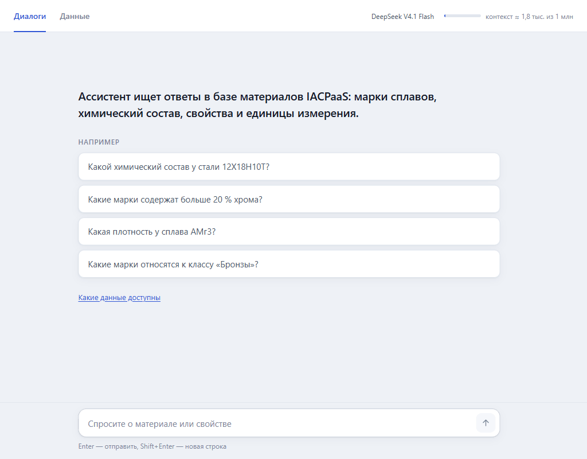

# Чат по базе материалов IACPaaS



Учебное локальное приложение. Пользователь задаёт вопрос в браузере. Агент (модель через RouterAI или локальная модель в LM Studio или Ollama) решает, нужны ли данные, и вызывает MCP-инструменты, а MCP-сервер читает разрешённые ресурсы IACPaaS. По явной просьбе агент создаёт папки и ресурсы в «Моём фонде», переименовывает вершины и удаляет ресурсы — каждую запись пользователь подтверждает кнопкой в интерфейсе. В интерфейсе видны вызовы инструментов и их результаты, источник данных (платформа или локальный индекс), расход токенов и стоимость в рублях.

Работаем с ресурсами, которые выдал преподаватель (папка «Загрузки», защищена от записи): справочник по материалам, база свойств, база химических элементов, система единиц, терминологический справочник и три онтологии. Что в них лежит — в разделе «Данные» интерфейса и в [docs/data.md](docs/data.md).

## Быстрый запуск

Нужны Python 3.11 или новее (проверено на 3.12) и доступ в интернет к IACPaaS и RouterAI (вместо RouterAI можно взять локальную модель — раздел «Локальная модель»). Команды выполняются из корня проекта.

```powershell
python -m venv .venv
.\.venv\Scripts\python.exe -m pip install -r requirements-lock.txt
.\.venv\Scripts\python.exe -m pip install --no-deps -e .
```

`requirements-lock.txt` — проверенные версии всех пакетов, включая pytest. Их стоит ставить именно так: агент расширяет внутренние методы `ChatOpenAI`, и новая версия `langchain-openai` может это сломать.

Скопируйте `.env.example` в `.env` и заполните:

```dotenv
IACPAAS_USERNAME=ваш_логин
IACPAAS_PASSWORD=ваш_пароль
ROUTERAI_API_KEY=ваш_ключ
ROUTERAI_MODEL=deepseek/deepseek-v4.1-flash
ROUTERAI_BASE_URL=https://routerai.ru/api/v1
```

Модель должна поддерживать tool calling. Имя `ROUTERAI_BASEURL` и старые `OPENROUTER_*` тоже поддерживаются. `.env` содержит секреты и исключён из Git; не прикладывайте его к отчёту.

```powershell
.\.venv\Scripts\python.exe -m materials_chat
```

Откройте [локальный чат](http://127.0.0.1:8000). Команда запускает веб-приложение и MCP-сервер. При первом запуске ресурсы загружаются из IACPaaS и строится локальный поисковый индекс (большой справочник — дольше остальных). Для остановки нажмите `Ctrl+C`.

В PyCharm та же команда — конфигурация запуска Python в режиме **module** (не script): модуль `materials_chat`, рабочая папка — корень проекта, интерпретатор — `.venv`. С параметром `sync` она обновляет индекс. Режим script не подойдёт: модули пакета импортируют друг друга относительно (`from .config import …`).

## Как устроен ответ

Агент построен на LangChain: `create_agent` собирает граф «модель → инструменты → модель», инструменты MCP-сервера подключаются через `langchain-mcp-adapters`, модель — `ChatOpenAI` с адресом RouterAI. Подробности — в [архитектуре](docs/architecture.md#как-работает-агент).

1. Модель получает вопрос, историю диалога и описания MCP-инструментов и **сама решает**, нужны ли данные.
2. На приветствие, вопрос о самом диалоге («что я спрашивал?») или просьбу показать уже найденное она отвечает сразу, без инструментов. На вопрос не по теме базы вежливо отказывает.
3. На вопрос о материалах она ищет (`search_graph`) и читает найденную вершину (`get_subgraph`), при необходимости несколько раз.
4. Вопросы по химическому составу («хрома больше 20 %», «топ-3 по хрому», «есть хром, нет никеля», «сколько марок, где железа больше 5 %») идут через `find_materials`: подбор считает сервер по всем маркам индекса, а не модель по страницам поиска. Вопросы «сколько свойств / элементов / классов» — через `count_graph` с понятием онтологии.
5. Если лимит шагов исчерпан, модель обязана ответить по уже найденному (инструменты на последнем шаге отключаются).

**Чем обеспечена воспроизводимость ответов.** Количество и списки считает сервер, а не модель: на «сколько марок, где железа больше 5 %» `find_materials` отдаёт точный `total` (1 026) одним вызовом, на «сколько свойств в базе» `count_graph` с `concept` — 28. Сравнение порогов гарантированное и описано в результате (`rules`). Температура модели — 0 (`MODEL_TEMPERATURE`). Повторный одинаковый вызов в одном ходе не выполняется (`REPEATED_CALL`), модель берёт уже полученный результат. После ответа числа сверяются с данными, а кнопка «Проверить» разбирает утверждения ответа (см. «Проверка ответов»).

Промпт запрещает подставлять факты из памяти модели. Под ответом видно, обращался ли агент к базе: ответ без инструментов помечен «без обращения к базе». Полные аргументы и результаты каждого вызова раскрываются в журнале. Вызов `find_materials` в журнале подписан «Подбирает марки по составу», а его аргументы — кратко, например «Cr > 20 · нет Ni · Сплавы на основе железа».

## Откуда берутся данные

У HTTP API IACPaaS есть выгрузка ресурса или его фрагмента, но нет поиска по тексту. Поэтому источник гибридный:

| Инструмент | Откуда данные |
|---|---|
| `search_graph` | Локальный SQLite-индекс — копия ресурсов, загруженная с платформы |
| `find_materials` | Локальный индекс: таблица состава марок, построенная из индекса при загрузке ресурсов |
| `get_subgraph`, `get_inforesource` | **Живой запрос к IACPaaS**: `GET /api/data/export/user-item` с `start-target-concept-path` и `export-depth` |
| `count_graph`, `validate_resource`, `list_inforesources` | Индекс и конфигурация |
| `get_subgraph`, `get_inforesource` с `path` | Любой ресурс «Моего фонда» по пути — только живой запрос к IACPaaS |
| `write_inforesource`, `delete_inforesource` | Запись в IACPaaS: создание папки, импорт ресурса, удаление (см. «Запись в IACPaaS») |

Если платформа недоступна, чтение базового ресурса берётся из индекса с пометкой «индекс — платформа недоступна» и причиной; чтение по `path` возвращает ошибку. Фрагменты больше 5000 вершин читаются из индекса (`LIVE_MAX_NODES`). Подробнее — в [docs/api-mapping.md](docs/api-mapping.md).

**Как индекс остаётся свежим.** При запуске приложения (`AUTO_SYNC_ON_START=true`, по умолчанию) пустой индекс загружается целиком. Готовый индекс сверяется с платформой: по каждому из восьми ресурсов выгружается только корень (`export-depth=0`) с датой изменения `date`, и она сравнивается с датой в индексе. Совпала — ресурс не выгружается; изменилась — ресурс выгружается целиком и переиндексируется, остальные не трогаются. Сверка идёт в фоне (восемь лёгких запросов по 5–8 секунд, проверено 02.11.2026 — около 35 секунд вместе с запуском): приложение сразу работает по сохранённому индексу. Если платформа недоступна, индекс остаётся как есть, а в разделе «Данные» видно, что сверить не удалось. Итог сверки — там же: «Сверено с IACPaaS …: изменений на платформе нет» или «обновлены изменившиеся — …».

Полностью индекс обновляется кнопкой «Обновить из IACPaaS» в разделе «Данные» (все ресурсы заново, без сверки дат) или из терминала:

```powershell
.\.venv\Scripts\python.exe -m materials_chat sync
```

Список ресурсов — `config/resources.json`; описание данных для интерфейса — `config/data_notes.json`. Для другой предметной области меняют эти файлы, выполняют синхронизацию и начинают новый чат.

## Запись в IACPaaS

Два записывающих инструмента: `write_inforesource` (`create_folder` — папка, `create_resource` — ресурс по одной из трёх онтологий проекта, `update_concept` — новое имя, значение или комментарий вершины) и `delete_inforesource` (в корзину или безвозвратно). Пример — сценарий 5 в [docs/scenarios.md](docs/scenarios.md).

- **JSON платформы пишет сервер.** Модель описывает ресурс деревом «понятие онтологии + имя или значение». Сервер проверяет дерево по онтологии из локального индекса и собирает universal JSON; недопустимое понятие, неверный тип значения или неподдерживаемая возможность онтологии — отказ с подсказкой. Структуру онтологии модель читает через `get_inforesource` (поле `structure`).
- **Где можно писать** — в любом месте «Моего фонда», кроме защищённых путей: восемь базовых ресурсов, вся папка «Загрузки» и `PROTECTED_PATHS`. Запись в защищённый путь отклоняется (`PROTECTED_RESOURCE`) при любом написании пути, раньше подтверждения и без обращения к платформе.
- **Подтверждение.** Перед каждой записью MCP-сервер запрашивает подтверждение через MCP elicitation, текст описывает фактическую операцию. В чате у вызова появляется карточка «Подтвердить / Отменить» с отсчётом 120 секунд (у удаления — в цвете опасности). Отмена, истекшее время, «Стоп», закрытая страница или клиент без elicitation — запись не выполняется. Подтвердить запись сама модель не может.
- **Чтение по пути.** `get_inforesource` и `get_subgraph` принимают `path` в «Моём фонде» («Демо агента / Мои свойства») и читают ресурс прямо с платформы; у вершин в выдаче `concept_path` — по нему `update_concept` находит вершину. Листинга папок в API нет: путь агент узнаёт от пользователя или из своей записи.
- **Изменение вершины — переимпортом.** Метод изменения вершины платформы (`PUT /api/data/update`) не работает, поэтому сервер выгружает ресурс, меняет вершину и импортирует ресурс заново с очисткой (тот же ресурс, у вершин новые `id`); при сбое возвращает исходную версию.
- **Не поддерживается:** добавление вершин в существующий ресурс, ссылки и клоны вершин других ресурсов (химический элемент в составе марки, единица измерения свойства), удаление и переименование папок, копирование фрагментов, удаление подграфов.

Настройки в `.env`: `WRITE_ENABLED` (по умолчанию `true`; `false` — только чтение, без записывающих инструментов и параметра `path`), `PROTECTED_PATHS` (ещё защищённые пути через `;`), `WRITE_CONFIRM_TIMEOUT_SECONDS` (120).

Перед большим `create_resource` модель может проверить дерево без записи: `validate_resource` с `ontology` и `items` отвечает `valid`, перечнем замечаний с подсказкой и описанием того, что будет создано.

## Токены, контекст и стоимость

- **Окно контекста и цены** берутся из каталога моделей провайдера при запуске. У `deepseek/deepseek-v4.1-flash` в RouterAI окно — 1 048 576 токенов. Если каталог окна не сообщает (локальный сервер), берётся окно, с которым модель загружена в LM Studio, затем `MODEL_CONTEXT_TOKENS`, иначе 32 768; `MODEL_CONTEXT_TOKENS` важнее всех. Откуда взято окно, видно в подсказке к имени модели в шапке.
- **Стоимость** показывается в рублях за каждый ответ и за весь диалог. Берётся сумма, которую RouterAI сообщает в ответе (`usage.cost`). Она заметно выше расчёта по прайсу каталога, но это фактическое списание. Если провайдер сумму не прислал, считаем по прайсу. Если нет ни суммы, ни цен, вместо стоимости написано «стоимость неизвестна» (в шапке — «—»), у локальной модели без цен — «бесплатно»; «0,00 ₽» без данных не показывается.
- **Контекст** — оценка размера истории, которая уйдёт в модель со следующим вопросом (индикатор в шапке). Как собирается история и как посмотреть её целиком — в разделе «История диалога».
- Стоимость проверки ответа (кнопка «Проверить») входит в стоимость диалога.
- Если нужно ограничить расходы, задайте мягкий лимит `MAX_CONTEXT_TOKENS` в `.env`. Остальные настройки описаны в `.env.example`.

## История диалога

**Где хранится.** Диалоги лежат в SQLite, `data/history.sqlite3` (`materials_chat/sessions.py`). У каждого ответа сохраняются текст, журнал инструментов с полными результатами, расход, сверка чисел и вердикт проверки, а также точная цепочка сообщений для модели (`model_messages`): какие инструменты вызывались, с какими аргументами и что вернули.

**Что уходит в модель.** С каждым новым вопросом модель получает системный промпт, описания инструментов, историю диалога и сам вопрос. История сжимается механически, без пересказа моделью:

- последние 2 хода уходят полностью;
- у более старых результат инструмента длиннее 1500 символов обрезается, к нему дописывается «…[сокращено: полный результат был получен в одном из прошлых ходов]», а рассуждения модели убираются;
- вопросы и ответы уходят целиком, пары «вызов инструмента → результат» сохраняются (иначе провайдер отклонит историю).

Поэтому уточнение «а сколько в ней никеля?» работает без нового поиска, а за подробностями старого результата модель снова вызывает инструмент. Пороги задаются в `.env`: `HISTORY_FULL_TURNS` (по умолчанию 2) и `HISTORY_TOOL_CHARS` (по умолчанию 1500).

**Панель «Что видит модель».** Нажмите на индикатор контекста в шапке («контекст ≈ N из …»). Панель показывает историю ровно в том виде, в каком она уйдёт в модель со следующим вопросом: системный промпт, ходы с пометкой «полностью» или «сокращён» и размером («≈ 4 299 токенов вместо 16 230»), вызовы инструментов с аргументами и результаты; у обрезанных результатов указано, сколько символов было. Модель и панель собирают историю одним кодом, поэтому показанное совпадает с отправленным. Данные — `GET /api/sessions/{id}/context`.

**Если история не помещается.** Перед каждым обращением к модели размер оценивается (длина JSON / 3) и сравнивается с бюджетом: окно модели минус место под ответ или мягкий лимит `MAX_CONTEXT_TOKENS`. Если не помещается, ход останавливается с ошибкой «Диалог превысил лимит контекста… Начните новый диалог»; старые ходы автоматически не выбрасываются. При окне 1 048 576 токенов на практике до этого не доходит.

**Почему без пересказа моделью.** Пересказ — лишний платный вызов на каждый ход, и он может потерять или исказить числа, а ответы должны опираться на данные. Обрезанный результат оставляет модели главное — что и где было найдено (`node_id`, имена), а полное можно перечитать инструментом.

**Между диалогами памяти нет.** Новый чат начинается с чистого контекста. Сверка чисел и проверяющий сжатия не видят: они берут полные журналы инструментов всех ходов до проверяемого ответа.

## Смена модели

Модель задаётся в `.env`, после правки приложение нужно перезапустить. Подходит любой сервер с протоколом OpenAI Chat Completions: RouterAI (по умолчанию), OpenRouter или локальный сервер LM Studio и Ollama (раздел «Локальная модель»). Имена `ROUTERAI_*` относятся к любому из них: `ROUTERAI_BASE_URL` — адрес API, `ROUTERAI_MODEL` — имя модели, `ROUTERAI_API_KEY` — ключ (локальному серверу не нужен). Код под конкретную модель не подстроен.

```dotenv
ROUTERAI_MODEL=qwen/qwen3.7-flash
```

- Имя пишется точно как `id` в каталоге провайдера: у RouterAI — `GET https://routerai.ru/api/v1/models` (ключ не нужен), у локального сервера — как в `lms ps` или `ollama list`.
- Модель должна поддерживать вызов инструментов (tool calling); в каталоге RouterAI у такой модели в `supported_parameters` есть `tools` и `tool_choice`. Агент переключает `tool_choice` между `auto` и `none` (на последнем шаге), проверяющий вызывает отчёт с `required`.
- Окно контекста и цены приложение берёт из каталога при запуске. Если каталог их не дал, окно считается 32 768 токенов, цены неизвестны; и то и другое можно задать в `.env` (`MODEL_CONTEXT_TOKENS`, `PRICE_*`). Без цен стоимость видна, только если провайдер присылает её в ответе.
- Время ожидания одного обращения к модели — `MODEL_TIMEOUT_SECONDS` (по умолчанию 120 секунд).
- Текущие провайдер и модель показаны в шапке интерфейса, цены и окно контекста — в подсказке к имени модели.
- Проверяющему можно дать отдельную модель — `VERIFIER_MODEL` (см. «Проверка ответов»).
- Температура агента и проверяющего — `MODEL_TEMPERATURE`, по умолчанию 0: на одинаковые вопросы модель отвечает с меньшим разбросом. RouterAI принимает её для `deepseek/deepseek-v4.1-flash` (проверено 02.11.2026).
- Промпт и сценарии проверены на `deepseek/deepseek-v4.1-flash`. Другая модель может иначе выбирать инструменты и делать больше вызовов, поэтому после смены стоит прогнать [сценарии демонстрации](docs/scenarios.md).

## Локальная модель

Вместо облачного провайдера модель может работать на этом компьютере: LM Studio и Ollama поднимают сервер с тем же протоколом OpenAI Chat Completions, и агент работает с ним без изменений в коде. Локальный сервер приложение узнаёт по адресу `ROUTERAI_BASE_URL`: `localhost`, `127.0.0.1`, `::1`, частные сети (`10.*`, `172.16–31.*`, `192.168.*`), `host.docker.internal`, имена `*.local` и имена без точки (сервис docker compose, например `ollama`). Для такого адреса:

- ключ не нужен: `ROUTERAI_API_KEY` можно оставить пустым, клиенту уходит заглушка;
- провайдер в шапке и в сообщениях об ошибках — «Локальная модель»;
- вместо стоимости написано «бесплатно»: цен у локального сервера нет, за токены никто не платит. Если задать `PRICE_*`, стоимость считается по ним;
- после тайм-аута запрос не повторяется: повтор снова занял бы всё время ожидания.

Любой другой адрес считается облачным, и ключ для него обязателен. Свой сервер без ключа по публичному адресу — `MODEL_LOCAL=true`; облачный провайдер за локальным прокси — `MODEL_LOCAL=false`.

**LM Studio.** Сервер — `http://127.0.0.1:1234/v1`.

```powershell
lms get https://huggingface.co/lmstudio-community/Qwen3-4B-Instruct-2507-GGUF   # или скачать в окне LM Studio
lms load qwen3-4b-instruct-2507 --context-length 32768 -y
lms server start
lms ps                     # IDENTIFIER — имя для ROUTERAI_MODEL, CONTEXT — фактическое окно
```

```dotenv
ROUTERAI_BASE_URL=http://127.0.0.1:1234/v1
ROUTERAI_MODEL=qwen3-4b-instruct-2507
ROUTERAI_API_KEY=
MODEL_TIMEOUT_SECONDS=600
```

Если `lms get` не может скачать модель («fetch failed» — так было на этой машине), положите файл `Qwen3-4B-Instruct-2507-Q4_K_M.gguf` с той же страницы Hugging Face в `%USERPROFILE%\.lmstudio\models\lmstudio-community\Qwen3-4B-Instruct-2507-GGUF\` — `lms ls` его увидит. Окно сверяйте по `lms ps`: на этой машине команда выше загрузила модель с окном 99 840 и четырьмя параллельными слотами, а не 32 768. Приложение берёт фактическое окно из API LM Studio при запуске, поэтому `MODEL_CONTEXT_TOKENS` для LM Studio не нужен, если модель загружена до запуска приложения. После работы: `lms unload --all` и `lms server stop`.

**Ollama.** Сервер — `http://127.0.0.1:11434/v1`. Окно контекста по умолчанию у Ollama — несколько тысяч токенов; длинный запрос агента Ollama молча обрезает, поэтому окно задаётся при запуске сервера:

```powershell
$env:OLLAMA_CONTEXT_LENGTH = "32768"
ollama serve
ollama pull qwen3:4b        # в другом окне
```

```dotenv
ROUTERAI_BASE_URL=http://127.0.0.1:11434/v1
ROUTERAI_MODEL=qwen3:4b
ROUTERAI_API_KEY=
MODEL_CONTEXT_TOKENS=32768
MODEL_TIMEOUT_SECONDS=600
```

**Какую модель брать.** Только с поддержкой вызова инструментов (tool calling): в LM Studio такие модели помечены значком инструмента, у Ollama — тегом `tools`. Подходят Qwen3 и Qwen3-2507 Instruct (4B и больше), Qwen2.5 Instruct (7B и больше), Llama 3.1 Instruct 8B, Mistral Small. Модель с рассуждениями (например, гибридная Qwen3) отвечает дольше: сначала пишет рассуждение; Qwen3-4B-Instruct-2507 рассуждений не пишет. Имя модели у Ollama — как в `ollama list`.

**Окно контекста.** Один запрос агента — около 6,6 тысячи токенов ещё до вопроса (системный промпт — около 1,8 тысячи, схемы девяти инструментов — около 4,8 тысячи), с прочитанной записью марки — 13–15 тысяч. Модель загружайте с окном не меньше 16 384 токенов, лучше 32 768. Окно приложение берёт так: `MODEL_CONTEXT_TOKENS`, если задано; иначе окно, с которым модель загружена в LM Studio (родной API LM Studio `/api/v0/models`); иначе 32 768. В подсказке к имени модели в шапке видно, откуда оно взято («с ним модель загружена в LM Studio», «задано в MODEL_CONTEXT_TOKENS», «по умолчанию»). Если окно в приложении больше настоящего, длинный запрос сервер отклонит или обрежет — это зависит от сервера; отказ сервера чат показывает его же текстом («Локальный сервер модели отклонил запрос…»).

**Время ответа.** Локальная модель на процессоре или встроенной видеокарте отвечает в разы медленнее облачной, особенно на первом шаге: модель читает весь запрос с описаниями инструментов. Время ожидания одного обращения — `MODEL_TIMEOUT_SECONDS` (по умолчанию 120 секунд); для локальной модели ставьте 300–600.

**Ограничения.**

- Качество малых моделей ниже: они чаще ошибаются в выборе инструмента и аргументах, пропускают источник, хуже следуют правилам промпта. Проще всего для них вопросы, где сервер считает сам (подбор по составу и подсчёт): один вызов вместо цепочки поисков и чтений. Проверяйте ответы журналом вызовов, сверкой чисел и кнопкой «Проверить».
- `tool_choice`: агент на последнем шаге отключает инструменты (`"none"`), проверяющий требует отчёт (`"required"`). Если сервер параметр не соблюдает, лишние вызовы на последнем шаге агент всё равно не выполняет, а проверяющий принимает отчёт и текстом в JSON; иначе — «Проверяющий вернул ответ в неожиданном формате».
- Рассуждения, которые модель присылает в тексте ответа как `<think>…</think>`, в ответ, историю и отчёт проверяющего не попадают.
- Нагрузка: модель 4B (2,5 ГБ) с окном в десятки тысяч токенов занимает в памяти ещё несколько гигабайт под кэш контекста; на ноутбуке со встроенной видеокартой это заметно тормозит систему. Не держите модель загруженной без дела: `lms unload --all`.
- Ошибки локального сервера объясняются в чате: не запущен — «Локальный сервер модели не отвечает по адресу …», нет модели — «Модель … не найдена на локальном сервере», переполнено окно — текст ошибки сервера, тайм-аут — «Локальная модель не ответила за N с».

**Что проверено (02.11.2026).**

- Автотесты (без сети): двойник локального сервера без ключа, цен и окна в каталоге — статус `configured`, ход и проверка ответа проходят, ключ не уходит (заглушка), стоимость — «бесплатно»; облачная модель без цен — стоимость `null`, а не 0; окно из API LM Studio, из `MODEL_CONTEXT_TOKENS` или по умолчанию; ошибки сервера (не запущен, нет модели, переполнено окно, тайм-аут); `<think>`, разрезанный между кусками потока; подписи стоимости интерфейса в Node.js.
- LM Studio на этой машине (Core Ultra 7 155H, встроенная Intel Arc, 32 ГБ): скачана и загружена `qwen3-4b-instruct-2507` (Q4_K_M, 2,5 ГБ, загрузка около 2 минут). Ответы сервера совпали с тем, на что рассчитано приложение: `/v1/models` отдаёт только `id` модели (ни окна, ни цен), `/api/v0/models/qwen3-4b-instruct-2507` — `state: "loaded"`, `loaded_context_length` и `capabilities: ["tool_use"]`.
- Вопросы через веб-чат на локальной модели не прогонялись: проверку остановили, потому что модель перегружала ноутбук. Как отвечает 4B-модель на вопросы проекта, не проверено.
- Веб-приложение с локальным адресом, на котором сервер не запущен: в шапке «Локальная модель», модель настроена без ключа, подсказка — «Бесплатно…» и «Окно контекста: 32 768 токенов — по умолчанию»; вопрос получает ошибку «Локальный сервер модели не отвечает по адресу …» через 2 секунды; в списке диалогов и под ответом — «бесплатно» и «стоимость неизвестна» вместо «0,00 ₽»; ошибок в консоли браузера нет.
- Ollama не проверялась.

## Как использовать MCP-сервер

Данные IACPaaS агенту отдаёт один MCP-сервер (`materials_chat/mcp_server.py`, девять инструментов). Пользоваться им можно тремя способами:

| Способ | Что запустить | Что получится | Что нужно |
|---|---|---|---|
| **Веб-чат проекта** | `.\.venv\Scripts\python.exe -m materials_chat` | Чат в браузере (http://127.0.0.1:8000). Агент LangChain из этого проекта ходит в MCP-сервер по Streamable HTTP; видны журнал вызовов, стоимость, сверка чисел и кнопка «Проверить», запись подтверждается карточкой в чате | `.venv`, `.env` с учётными данными IACPaaS и моделью (RouterAI или локальная). Индекс строится сам при первом запуске |
| **Агент в чате VS Code** | Открыть папку проекта в VS Code, в чате выбрать агента «IACPaaS Материалы» | VS Code сам запускает MCP-сервер по `.vscode/mcp.json` (stdio); отвечает модель Copilot, пользуясь только инструментами сервера; запись подтверждается диалогом VS Code | VS Code с Copilot, `.venv`, построенный индекс, `.env` с учётными данными IACPaaS (ключ модели не нужен). Подробно — подраздел «VS Code» |
| **Любой MCP-клиент** | Claude Desktop, Cursor и другие — описание сервера в `mcpServers`; MCP Inspector — проверка сервера без агента (команды ниже) | Те же инструменты в чужом агенте или в окне отладки: список инструментов, вызов с аргументами, ответ сервера | `.venv`, построенный индекс, `.env` с учётными данными IACPaaS. Ключ модели серверу не нужен — модель у клиента своя |

Индекс сам MCP-сервер не строит: его строит веб-приложение при первом запуске или команда `python -m materials_chat sync`. Без индекса инструменты отвечают `INDEX_NOT_READY`.

### Веб-чат проекта

Запуск и настройка — в разделе «Быстрый запуск». Команда поднимает два процесса: MCP-сервер на `http://127.0.0.1:8001/mcp` (`MCP_URL`) и веб-приложение на `http://127.0.0.1:8000`. Чтобы веб-чат подключился к уже запущенному отдельно MCP-серверу, запустите его с `--web-only`.

### VS Code

В проекте уже есть конфигурация MCP-сервера для рабочей папки (`.vscode/mcp.json`) и свой агент для чата VS Code (`.github/agents/iacpaas-materials.agent.md`). Нужны VS Code с чатом Copilot в режиме агента (вход в GitHub-аккаунт с Copilot) и установленный по разделу «Быстрый запуск» `.venv` с построенным индексом. В `.env` достаточно учётных данных IACPaaS: модель здесь — модель Copilot, ключ RouterAI не нужен.

**Что такое `.github/agents/iacpaas-materials.agent.md`.** Это не GitHub Actions и не CI: в нём нет шагов сборки и он ничего не запускает на github.com. Это файл своего агента (custom agent) GitHub Copilot для чата VS Code; VS Code ищет такие файлы в папке `.github/agents/` рабочей папки. В шапке YAML — имя «IACPaaS Материалы», описание и `tools: ['iacpaas/*']`: агенту доступны только инструменты MCP-сервера `iacpaas` из `.vscode/mcp.json`, а файлы, терминал и интернет — нет. Ниже шапки — инструкция в Markdown: роль, девять инструментов, правила (отвечать только по данным, подсчёт и подбор — через `find_materials` и `count_graph`, запись — только по просьбе и с подтверждением) и формат ответа; она повторяет системный промпт веб-чата. Как это работает: выбранный в чате агент получает эту инструкцию, VS Code сам запускает MCP-сервер по `.vscode/mcp.json` (по stdio, интерпретатор из `.venv`), модель — та, что выбрана в Copilot. На github.com (Copilot coding agent в облаке) этот агент без настроенного там MCP-сервера работать не будет: серверу нужны локальные `.venv`, индекс `data/search.sqlite3` и учётные данные IACPaaS из `.env`, которых в репозитории нет.

1. Откройте папку проекта в VS Code (`code .`). При первом запуске сервера `iacpaas` VS Code спросит, доверять ли ему, — подтвердите.
2. Откройте чат и в списке агентов выберите «IACPaaS Материалы».
3. Спросите, например: «Сколько марок, где железа больше 5 %?» или «Какой химический состав у стали 12Х18Н10Т?». Запись («Создай в папке «Демо агента» папку «Проба VS Code»») VS Code подтверждает своим диалогом (MCP elicitation): «Принять» — запись выполняется, «Отклонить» — нет. Модель в VS Code — модель Copilot; MCP-сервер и данные те же, что у веб-чата.

`mcp.json` запускает сервер по stdio: `${workspaceFolder}/.venv/Scripts/python.exe -m materials_chat.mcp_server --transport stdio` с `PYTHONIOENCODING=utf-8`. Подключиться к уже запущенному серверу веб-приложения можно и по HTTP: замените описание сервера на `{"type": "http", "url": "http://127.0.0.1:8001/mcp"}`.

**Диагностика.** Палитра команд → «MCP: List Servers» → `iacpaas`: запуск, остановка, перезапуск и «Show Output» — журнал сервера (там же строки «Запись IACPaaS: …» о каждой попытке записи).

| Симптом | Причина и что сделать |
|---|---|
| Сервер не стартует, в журнале «No such file» | Нет `.venv` или он в другом месте — выполнить установку из «Быстрого запуска» либо поправить `command` в `mcp.json` |
| `ModuleNotFoundError: materials_chat` | Пакет не установлен в `.venv`: `pip install --no-deps -e .` |
| `UnicodeEncodeError` в журнале | Не задан `PYTHONIOENCODING=utf-8` (он есть в `mcp.json`; нужен при запуске вручную) |
| Инструменты отвечают `INDEX_NOT_READY` | Индекс не построен: `python -m materials_chat sync` или один запуск веб-приложения |
| Агент не видит инструментов | Сервер не запущен или выключен в «Configure Tools» чата; проверить «MCP: List Servers» |
| Запись отвечает `CONFIRMATION_UNAVAILABLE` | Клиент не поддерживает elicitation (в VS Code поддержка есть с версии 1.102) |

Проверка без VS Code — тот же запуск из теста `tests/test_vscode.py`: сервер стартует командой из `mcp.json`, отдаёт 9 инструментов и отвечает на вопрос про железо одним вызовом.

### Любой MCP-клиент

MCP-сервер подключается к любому агенту, который умеет MCP по stdio или Streamable HTTP: Claude Code, Claude Desktop, Cursor, MCP Inspector, OpenAI Agents SDK, LangChain. Оба транспорта используют одну доменную логику:

```powershell
# Локальный процесс: сообщения MCP идут по stdin/stdout.
.\.venv\Scripts\python.exe -m materials_chat.mcp_server --transport stdio

# HTTP: endpoint http://127.0.0.1:8001/mcp
.\.venv\Scripts\python.exe -m materials_chat.mcp_server --transport streamable-http --host 127.0.0.1 --port 8001
```

Пока работает веб-приложение, его MCP-сервер уже доступен по `http://127.0.0.1:8001/mcp` (`MCP_URL`); отдельный HTTP-сервер в это время запускайте на другом порту. Отдельному MCP-серверу нужен только доступ к IACPaaS; ключ модели нужен агенту.

Клиенту, который сам запускает сервер по stdio (формат `mcpServers` у Claude Desktop и Cursor), достаточно указать интерпретатор из `.venv`:

```json
{
  "mcpServers": {
    "iacpaas-materials": {
      "command": "C:\\путь\\к\\проекту\\.venv\\Scripts\\python.exe",
      "args": ["-m", "materials_chat.mcp_server", "--transport", "stdio"],
      "env": {"PYTHONIOENCODING": "utf-8"}
    }
  }
}
```

Рабочая папка клиента не важна: `.env`, индекс и список ресурсов сервер находит в корне проекта.

**Проверка сервера без агента — MCP Inspector** (нужен Node.js; пакет `npx` скачает сам). Сервер запускается по HTTP (команда выше или веб-приложение), Inspector к нему подключается:

```powershell
# Окно в браузере: Transport Type — Streamable HTTP, URL — http://127.0.0.1:8001/mcp, Connect → Tools → List Tools.
npx @modelcontextprotocol/inspector

# То же из терминала: список инструментов и один вызов.
npx @modelcontextprotocol/inspector --cli http://127.0.0.1:8001/mcp --transport http --method tools/list
npx @modelcontextprotocol/inspector --cli http://127.0.0.1:8001/mcp --transport http --method tools/call --tool-name count_graph --tool-arg resource_id=properties --tool-arg concept=Свойство
```

Команды из терминала проверены 02.11.2026: сервер отдал девять инструментов, `count_graph` с понятием «Свойство» — 28.

### Что сервер даёт любому клиенту

**Что получает любой агент** — это обеспечивает сервер: поиск и подсчёт только по ресурсам из `config/resources.json` (иначе `UNKNOWN_RESOURCE`); чтение любого ресурса «Моего фонда» по пути; защита базовых ресурсов и «Загрузок» от записи; подтверждение каждой записи через MCP elicitation — клиент без elicitation писать не может (`CONFIRMATION_UNAVAILABLE`), клиент с ним показывает свой запрос; лимиты глубины, размера и страниц (`LIMIT_EXCEEDED`); ошибки как результат с кодом; источник данных (`served_from`, дата снимка) в каждом результате.

**Что остаётся в веб-чате** — это часть агента, а не сервера: правила промпта (`materials_chat/prompts.py`: не подставлять факты из памяти, переспрашивать при неясном объекте, вопросы по составу решать через `find_materials`, называть дату снимка), лимит шагов и вызовов за ход, сверка чисел и кнопка «Проверить», расход и стоимость. Другой агент видит только описания инструментов и их схемы.

Ограничения отдельного MCP-сервера:

- HTTP работает без авторизации и слушает только `127.0.0.1`. Открывать его в сеть (`--host 0.0.0.0`) не следует. HTTP-режим — с сессией (заголовок `Mcp-Session-Id`, ответы потоком SSE): без него сервер не может посреди вызова спросить подтверждение у клиента.
- Облачные агенты (коннекторы веб-версий чатов) локальный сервер не видят: им нужен публичный HTTPS-адрес с авторизацией, в проекте его нет.
- В Docker наружу открыт только порт веб-приложения 8000; MCP-сервер доступен лишь внутри контейнера.
- Агенту без поддержки MCP нужен адаптер, как `langchain-mcp-adapters` в этом проекте.

## Проверки

```powershell
.\.venv\Scripts\python.exe -m pytest
```

Тесты используют небольшие графы, подменённую платформу и локальный двойник модели. Платных запросов они не делают. Есть и полный прогон «HTTP → агент → настоящий MCP → индекс», в том числе запись с подтверждением через эндпоинт решения. Результаты проверки с реальной моделью и платформой — в [docs/verification.md](docs/verification.md).

## Docker как дополнительный способ запуска

```powershell
docker compose up --build
```

Адрес тот же: http://127.0.0.1:8000. Контейнер берёт секреты из `.env`, а индекс и историю — из локальной папки `data`, общей с запуском через Python; одновременно оба способа не запускайте (порт 8000). Образ ставит зависимости из `requirements-lock.txt`. Сборка и работа проверены 20.10.2026 — см. [docs/verification.md](docs/verification.md). Первая сборка долгая (несколько минут: базовый образ и пакеты), следующие — секунды, пока не меняется lock-файл. Остановить: `docker compose down`.

## Что где находится

- [Архитектура](docs/architecture.md), [HTTP API веб-приложения](docs/http-api.md), [MCP-инструменты и API IACPaaS](docs/api-mapping.md).
- [Описание данных](docs/data.md) и [сценарии демонстрации](docs/scenarios.md).
- `materials_chat/` — сервер, агент, MCP и интерфейс (`static/`).
- `config/` — разрешённые ресурсы и описание данных.
- `data/` — индекс и сохранённые диалоги (рабочие данные, не в Git).
- `.vscode/mcp.json` и `.github/agents/iacpaas-materials.agent.md` — MCP-сервер и свой агент для VS Code (раздел «VS Code»).

Три способа работы с одним MCP-сервером — веб-чат проекта, агент в чате VS Code и любой MCP-клиент — описаны в разделе «Как использовать MCP-сервер».

## Если что-то не работает

| Симптом | Что проверить |
|---|---|
| Ошибка входа в IACPaaS | Логин и пароль в `.env`; вход на сайт под тем же аккаунтом |
| В журнале «индекс — платформа недоступна» | Сеть и доступность iacpaas.dvo.ru; ответ всё равно построен по снимку |
| «Ключ RouterAI отклонён» / «Недостаточно средств» | Ключ и баланс в кабинете RouterAI |
| «Стоимость неизвестна» вместо суммы | Каталог моделей провайдера был недоступен при запуске или в нём нет цен этой модели; перезапустите или задайте `PRICE_*` в `.env` |
| «Локальный сервер модели не отвечает по адресу …» | Сервер LM Studio или Ollama не запущен: `lms server start` или `ollama serve`; адрес — `ROUTERAI_BASE_URL` |
| «Модель … не найдена на локальном сервере» | Модель не загружена или имя не совпадает: `lms ps` / `ollama list`, имя — в `ROUTERAI_MODEL` |
| «Локальная модель не ответила за N с» | Модель не успевает на процессоре или встроенной видеокарте: увеличьте `MODEL_TIMEOUT_SECONDS` или возьмите модель меньше |
| «Не удалось сверить» в разделе «Данные» | Платформа не ответила при сверке дат на старте; приложение работает по сохранённому индексу, обновить его можно кнопкой «Обновить из IACPaaS» |
| Нет совпадений | Поиск лексический: короткое название или точная марка |
| Порт занят | Остановить предыдущий экземпляр или изменить `APP_PORT`/`MCP_PORT` |
| PyCharm не видит библиотеки, импорты подчёркнуты | В пути к проекту кириллица, а кодовая страница Windows не UTF-8: служебный скрипт PyCharm падает с `UnicodeEncodeError`. Задайте переменную пользователя `PYTHONIOENCODING=utf-8` и перезапустите PyCharm |

## Подбор марок по составу

Инструмент `find_materials` принимает условия на содержание элементов, класс материалов, сортировку и страницу. Он считает по всем маркам справочника (1 334) в локальном индексе: таблица состава строится из индекса при его загрузке, а для уже существующего индекса — при первом обращении. Результат содержит `total` (сколько марок подходит), страницу марок (`limit` от 1 до 50, продолжение — `next_offset` при `has_more`) и дату снимка.

Правила подбора:

- **Содержание элемента — диапазон.** «17–19 %» — это [17, 19]; «не более 0,5» — [0; 0,5]; «не менее 2» — [2; 100]; число X — [X, X]. «Расчётное», «совокупность элементов» и запись без значения — диапазон неизвестен.
- **Основа сплава — остаток до 100 %.** У 1 014 сталей и сплавов основа (чаще всего железо) записана как «не более X». Её нижняя граница — 100 % минус верхние границы остальных элементов, но не выше X (форма «Основа (остаток)»). Так «железа больше 5 %» находит 1 026 марок (индекс на 02.11.2026), а не только 21 марку с явным интервалом железа. Если у какого-то элемента предел неизвестен или в записи только основа, остаётся «не более X».
- **Сравнение только гарантированное.** «Больше X» — нижняя граница диапазона больше X; «меньше X» — верхняя граница меньше X. Поэтому «Cr > 20» не возвращает марку с хромом 17–19 %.
- **Марки, где элемент не указан,** по умолчанию не проходят «меньше X»: отсутствие в записи не означает 0 %. Флаг `include_unlisted` у условия добавляет их; такие марки помечены «не указан в составе».
- **«Есть элемент»** — элемент перечислен в составе в любой форме, включая «не более». Гарантированное присутствие — условие «> 0».
- **Элемент, которого нет ни в одном составе** (например, Br или W): на «есть» ответ пустой, на «нет» подходят все марки; в ответе `elements_not_in_compositions` («в составах не встречается»).
- **Рейтинг по элементу** (`sort_by`) строится по нижней границе, при равенстве — по верхней. Записи «не более X» (пределы примесей) оказываются внизу. Сортировка подразумевает, что элемент в составе есть.
- Условия соединяются через «И»; для «или» модель делает несколько вызовов. Условия по свойствам (плотность и т. п. заполнены только у 7 марок) не поддерживаются.

У `search_graph` предел `limit` — 20; ответ содержит полную копию вершины, а `has_more: false` означает, что найдено всё.

## Проверка ответов

Ответ проверяется в два слоя: сверка чисел работает сама и ничего не стоит, проверяющий запускается кнопкой «Проверить» и стоит отдельного обращения к модели.

**Сверка чисел** выполняется автоматически в конце каждого хода (`materials_chat/answer_check.py`). Каждое число ответа ищется в полях данных, которые инструменты вернули в этом диалоге (значения, имена, комментарии, `id` вершин, `total`); служебные поля (`limit`, `offset`, даты) не учитываются. Не проверяются числа из вопроса (их назвал пользователь) и из аргументов удачных вызовов (их модель взяла в запрос), а также даты («21.10.2026», «18 октября 2026 г.»), номера пунктов списка и номера строк в первой ячейке таблицы. Аргументы неудачных вызовов не в счёт: если модель сослалась на вершину, которую сама придумала и получила `NODE_NOT_FOUND`, число подсветится. Результат сохраняется вместе с сообщением. Под ответом видно «Числа сверены с данными: N из N» или «Не найдены в данных: … — проверьте» (такие числа подсвечены в тексте); если в ответе нет чисел, ничего не показывается, а «нет данных для сверки» появляется только когда числа в ответе есть, но данные из базы не запрашивались.

**Кнопка «Проверить»** — синяя кнопка в конце строки под ответом — запускает проверяющего (`materials_chat/verifier.py`) на конкретном ответе. Это отдельное обращение к модели без инструментов: она разбивает ответ на утверждения о данных и по каждому выносит статус «подтверждено», «нет в данных» или «противоречит данным» с опорой на вершину (`node_id`) и выдержкой из данных.

Ход проверки виден сразу: под ответом появляется блок с секундомером и бегущей полосой, а утверждения добавляются в список по одному, как только модель их дописала (сервер отдаёт их потоком). У каждого утверждения есть дословная цитата из ответа. Нажатие на неё прокручивает ответ к этому месту и на несколько секунд подсвечивает фрагмент цветом статуса; цитата из таблицы подсвечивается через ячейки строки. Если модель процитировала неточно и фрагмент в тексте не найден, цитата показывается без ссылки. После проверки кнопка называется «Проверить снова». Судит она только по данным удачных вызовов этого диалога; к каждому результату приложен источник (ресурс, дата снимка, живое чтение или снимок), по нему сверяются утверждения об источнике. Итог: «Подтверждено X из Y утверждений (Z %)» и вердикт: 100 % — «подтверждён», от 70 % — «частично подтверждён», иначе «не подтверждён»; если утверждений о данных нет — «нет утверждений о данных». У проверяющего свой лимит ответа — 16 384 токена; если отчёт всё же обрезан, проверка завершается ошибкой, а не вердиктом по неполному списку утверждений. Модель проверяющего задаёт `VERIFIER_MODEL` в `.env`, по умолчанию это `ROUTERAI_MODEL`; окно и цены другой модели берутся из каталога провайдера (если её там нет — окно как у модели агента, стоимость только из ответа провайдера). Вердикт сохраняется в диалоге; повторная проверка заменяет его, а стоимость всех выполненных проверок накапливается и входит в стоимость диалога (расход проверки, завершившейся ошибкой, в неё не попадает). Если в диалоге не было удачных вызовов инструментов, проверка не запускается: проверять ответ не с чем. Исправлять ответ автоматически проверяющий не умеет.

Чего проверки не ловят:

- Сверка чисел подтверждает, что число встречается в данных, но не что оно относится к нужной марке или элементу. Если ответ припишет хрому число, которое в данных стоит у никеля, сверка его засчитает. Привязку чисел к объектам оценивает проверяющий.
- По умолчанию проверяющий — та же модель, что написала ответ. Для независимой проверки задайте в `VERIFIER_MODEL` другую модель.
- Вердикт проверяющего — оценка модели, а не доказательство. Опора у каждого утверждения (`node_id` и цитата) позволяет перепроверить его вручную.
