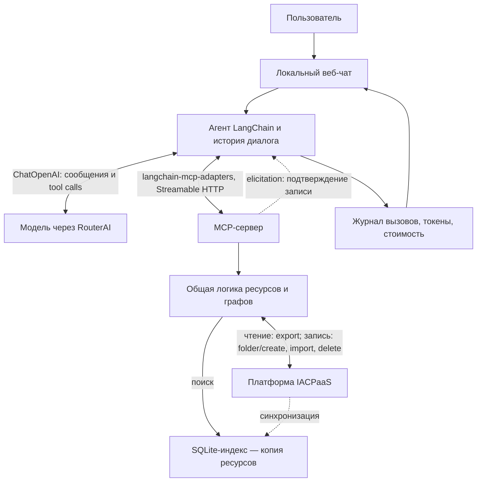

# Архитектура и объяснение проекта

## Задача

Приложение отвечает на вопросы по выбранному набору информационных ресурсов IACPaaS. Оно читает существующие сведения и показывает, какие инструменты использованы для ответа. Новые сведения о материалах не вычисляются, базовые ресурсы не изменяются. По явной просьбе пользователя агент создаёт папки и ресурсы в «Моём фонде», переименовывает вершины своих ресурсов и удаляет их — каждую такую запись пользователь подтверждает сам.

## Как устроены исходные данные

«Материалы и их свойства» — предметная область. Технически она ограничена списком разрешённых ресурсов, у каждого свой путь в «Мой Фонд». Папка «Загрузки» только организует эти ресурсы; отдельной онтологией она не является.

Онтология описывает допустимые понятия, свойства и отношения. База знаний содержит конкретные сведения, описанные по этой структуре. По одной онтологии можно создать разные базы. И онтология, и база представлены графами: вершины описывают понятия и значения, связи соединяют их, ссылки могут вести в другие ресурсы. Формат задаёт [документация JSON IACPaaS](https://iacpaas.dvo.ru/docs/Json/Json.html). Что именно лежит в наших восьми ресурсах — в [docs/data.md](data.md).

При чтении используется формат `universal`: у вершин есть идентификаторы, имена или значения, метки метапонятий и потомки `successors`. Приложение приводит его к компактным вершинам и дугам.

Граница области задаётся разрешёнными путями в `config/resources.json`, а не догадкой модели. Чтобы перейти на другой набор ресурсов, меняют этот файл (и описание `config/data_notes.json`), а затем перестраивают индекс.

## Гибридный доступ к платформе

HTTP API платформы умеет выгружать ресурс целиком или фрагмент от заданной вершины на заданную глубину. Поиска по тексту в нём нет. Поэтому:

- **Поиск** идёт по локальному SQLite-индексу. При синхронизации ресурсы выгружаются с платформы целиком; индекс — их снимок с датой.
- **Подбор по составу** (`find_materials`, `materials_chat/composition.py`) тоже идёт по индексу: таблица состава марок строится из него, условия и сортировку считает сервер.
- **Чтение** найденной вершины (`get_subgraph`) и метаданных ресурса (`get_inforesource`) идёт **прямо на платформу**. Путь к вершине восстанавливается по индексу: имена от корня, например `/Сплавы на основе железа/12Х18Н10Т`. Если платформа недоступна, ответ берётся из индекса с явной пометкой.

В журнале каждого вызова видно, откуда пришли данные: «IACPaaS», «индекс» или «индекс — платформа недоступна». Подробности и коды ошибок — в [api-mapping.md](api-mapping.md).

Лимиты числа результатов, глубины и размера ответа не дают передать модели весь большой справочник (около 94 тысяч вершин). Усечение всегда помечено: ограниченная выборка не доказывает отсутствия других записей.

## Как работает агент

Режимов два, MCP-сервер у них общий: самостоятельный веб-чат с агентом на LangChain (ниже) и агент «IACPaaS Материалы» в чате VS Code (`.github/agents/iacpaas-materials.agent.md`, модель Copilot, сервер подключён через `.vscode/mcp.json` по stdio). Правила агента VS Code повторяют системный промпт веб-чата.

Агент построен на LangChain (`materials_chat/agent.py`). Функция `create_agent` собирает граф LangGraph из двух узлов: `model` (обращение к модели) и `tools` (выполнение запрошенных инструментов). Переход между ними зависит от того, попросила ли модель инструменты (`tool_calls`). Правила приложения добавлены одним middleware `TurnPolicy`, а стандартный цикл не переписан.

| Часть | Из LangChain | Что добавлено в проекте |
|---|---|---|
| Инструменты | `langchain-mcp-adapters`: `load_mcp_tools` превращает инструменты MCP-сервера (имя, описание, JSON Schema) в инструменты LangChain | Одна MCP-сессия на вопрос (`mcp_client.py`) |
| Модель | `ChatOpenAI` с адресом RouterAI | Подкласс `RouterAIChat` (`openrouter.py`) сохраняет фактическую стоимость `usage.cost` и рассуждения `reasoning_details`, которые стандартный класс отбрасывает |
| Цикл | граф `create_agent`, параллельное выполнение инструментов | `TurnPolicy.awrap_model_call`: `tool_choice="auto"`, на последнем шаге `"none"` и подсказка «ответь по найденному»; проверка размера контекста; учёт расхода |
| Вызов инструмента | узел `tools` | `TurnPolicy.awrap_tool_call`: лимит вызовов, события для интерфейса, журнал, результат в виде JSON-конверта |
| Подтверждение записи | `elicitation_callback` клиентской сессии MCP (через `session_kwargs`) | `Agent.elicit`: событие `confirm_request` в поток хода, ожидание решения пользователя, итог карточки в записи журнала вызова |
| Поток | `astream` с режимами `messages` (текст модели), `custom` (события middleware), `values` (состояние графа) | Перевод в события SSE интерфейса |

Ход одного вопроса:

1. Сервер принимает сообщение и собирает историю диалога. Последние два хода передаются полностью, у более старых результаты инструментов сокращаются. История хранится в формате Chat Completions; `convert_to_messages` превращает её в сообщения LangChain.
2. MCP-клиент открывает сессию и получает описания инструментов (JSON Schema).
3. Модель получает системную инструкцию, историю и инструменты (`tool_choice="auto"`) и **сама решает**, нужны ли данные.
4. Если модель запросила инструменты, узел `tools` выполняет их через MCP (несколько вызовов одного шага — параллельно) и возвращает структурированные результаты. Удачное чтение с теми же именем и аргументами в этом ходе повторно не выполняется: модель получает `REPEATED_CALL` и берёт прежний результат. Запись повтором не считается, а после удачной записи чтение выполняется заново. Цикл повторяется.
5. На последнем разрешённом шаге (`MAX_TOOL_STEPS`) или после `MAX_TOOL_CALLS` вызовов инструменты отключаются (`tool_choice="none"`). Модель обязана ответить по уже найденному. Вызовы сверх лимита не выполняются и получают ответ-ошибку `tool_limit`.
6. Текст ответа идёт в интерфейс потоком; после ответа отправляются признак «опирался ли ответ на данные» и расход.
7. В конце хода `answer_check.py` сверяет числа ответа с данными вызовов; результат сохраняется в сообщении и уходит в интерфейс событием `number_check`.

В LangChain есть готовые лимиты, но они ведут себя иначе. `ModelCallLimitMiddleware` при исчерпании лимита завершает агента служебным сообщением или исключением. `ToolCallLimitMiddleware` отвечает ошибкой на лишние вызовы, но оставляет модели инструменты, и она может продолжать их просить. Нам нужен последний запрос с отключёнными инструментами, чтобы модель ответила по найденным данным. Поэтому лимиты реализованы в своём middleware.

Запрет на выдуманные факты обеспечивают промпт, видимые источники и журнал. Ответы без обращения к инструментам (приветствие, вопрос о диалоге, отказ не по теме) не подменяются шаблоном, а помечаются в интерфейсе. Языковая модель остаётся вероятностной: журнал позволяет проверить соответствие ответа данным, а проверочные сценарии выявляют нарушения.

Кнопка «Проверить» у ответа запускает `verifier.py`: отдельное обращение к модели без инструментов (`VERIFIER_MODEL`), которая разбирает ответ на утверждения и сверяет их с данными диалога. Утверждения приходят в интерфейс потоком, по мере готовности, каждое — с дословной цитатой из ответа, по которой можно перейти к месту в тексте. Вердикт сохраняется в сообщении, стоимость входит в стоимость диалога.

Ошибки провайдера (лимит контекста, ключ, баланс, тайм-аут) доходят до пользователя своим текстом. Внутри MCP-сессии библиотека anyio заворачивает исключения в `ExceptionGroup`, поэтому агент поднимает ошибку уже после выхода из сессии.

## Что показывает интерфейс

- **Диалоги** — список чатов, поток ответа, журнал инструментов (аргументы, результат, длительность, источник данных). У записывающего вызова — карточка «Подтвердить / Отменить» с обратным отсчётом (у удаления — в цвете опасности); после решения в журнале остаётся итог.
- **Данные** — подготовленное описание выданных ресурсов (`GET /api/data/overview`): классы материалов и число марок, свойства, единицы, онтологии, примеры вопросов; состояние индекса и кнопка обновления.
- **Расход** — токены и стоимость в рублях за ответ и за диалог, оценка заполнения контекста относительно окна модели. Окно и цены берутся из каталога RouterAI, фактическая стоимость — из ответа провайдера.

Контракт между сервером и интерфейсом описан в [http-api.md](http-api.md). Внутренние рассуждения модели не показываются. История чата хранится локально в SQLite, отдельно от контекстных инфоресурсов IACPaaS.

## Политика доступа

Инструменты разделены на читающие (7, аннотация MCP `readOnlyHint: true`) и записывающие (`write_inforesource`, `delete_inforesource`: `readOnlyHint: false`, `destructiveHint: true`). Запись включена настройкой `WRITE_ENABLED` (по умолчанию `true`); при `false` сервер публикует только чтение.

Барьер записи — на MCP-сервере (`materials_chat/writes.py`), общий для HTTP и stdio:

1. **Защищённые пути.** Восемь базовых ресурсов из `config/resources.json`, вся папка «Загрузки» и пути из `PROTECTED_PATHS` не изменяются и не удаляются, даже если права платформы это позволяют. Путь сравнивается по сегментам, без учёта регистра, лишних «/» и префикса «Мой Фонд», так что обходные написания тоже отклоняются. Отказ `PROTECTED_RESOURCE` приходит до подтверждения и до любого запроса к платформе.
2. **Проверка по онтологии.** Модель описывает ресурс деревом «понятие онтологии + имя или значение», сервер проверяет его по онтологиям проекта и сам собирает JSON платформы. Недопустимое понятие, неверный тип значения или неподдерживаемая возможность онтологии — понятный отказ с подсказкой.
3. **Подтверждение пользователя.** Сервер запрашивает его через MCP elicitation, текст строит из фактических аргументов. Веб-чат показывает карточку «Подтвердить / Отменить» в журнале хода; решение приходит отдельным запросом `POST /api/sessions/{id}/confirmations/{confirmation_id}` от кнопки, у модели пути подтвердить нет. Отмена, 120 секунд без ответа, «Стоп», закрытая страница или клиент без elicitation — запись не выполняется.

Каждая попытка записи пишется одной строкой в журнал MCP-сервера. Подтверждение чтения не требуется: любой ресурс «Моего фонда» можно прочитать по пути (`get_inforesource` и `get_subgraph` с `path`).

JWT запрашивается входом в IACPaaS; пароль и ключ RouterAI читаются из локального `.env`. Значения секретов не попадают в результаты инструментов и журнал. Собственной авторизации у веб-чата нет: это локальный учебный экземпляр.

## Соответствие заданию

| Требование | Реализация или согласованная граница |
|---|---|
| MCP-адаптер к фактическому API | Вход, экспорт, создание папки, импорт и удаление IACPaaS; чтение вершин напрямую с платформы; сопоставление в api-mapping.md |
| HTTP и stdio | Два транспорта одной общей логики: HTTP — для веб-чата, stdio — для VS Code и других MCP-клиентов |
| Типизированные аргументы и структурированные результаты | Схемы инструментов, проверки аргументов, диагностируемые ошибки |
| Самостоятельный агент (LangChain/LangGraph) | `create_agent` из LangChain, инструменты через `langchain-mcp-adapters`, RouterAI, веб-интерфейс |
| Трасса вызовов | События инструментов и результаты в чате, сохраняются в истории |
| Чтение и изменение разделены | 7 читающих и 2 записывающих инструмента с аннотациями MCP; запись — защита базовых ресурсов, проверка по онтологии и обязательное подтверждение пользователя через MCP elicitation |
| Интеграция VS Code | `.vscode/mcp.json` (сервер по stdio), свой агент `.github/agents/iacpaas-materials.agent.md` (роль, только инструменты сервера `iacpaas`, правила), запуск и диагностика — в README, сценарии — в `docs/scenarios.md` |
| Детерминированность ответов | Количество и подбор считает сервер одним вызовом (`find_materials`, `count_graph` с понятием), температура модели 0, защита от повторных вызовов, сверка чисел и проверяющий |
| Демонстрационные сценарии | `docs/scenarios.md`, результаты — `docs/verification.md` |
