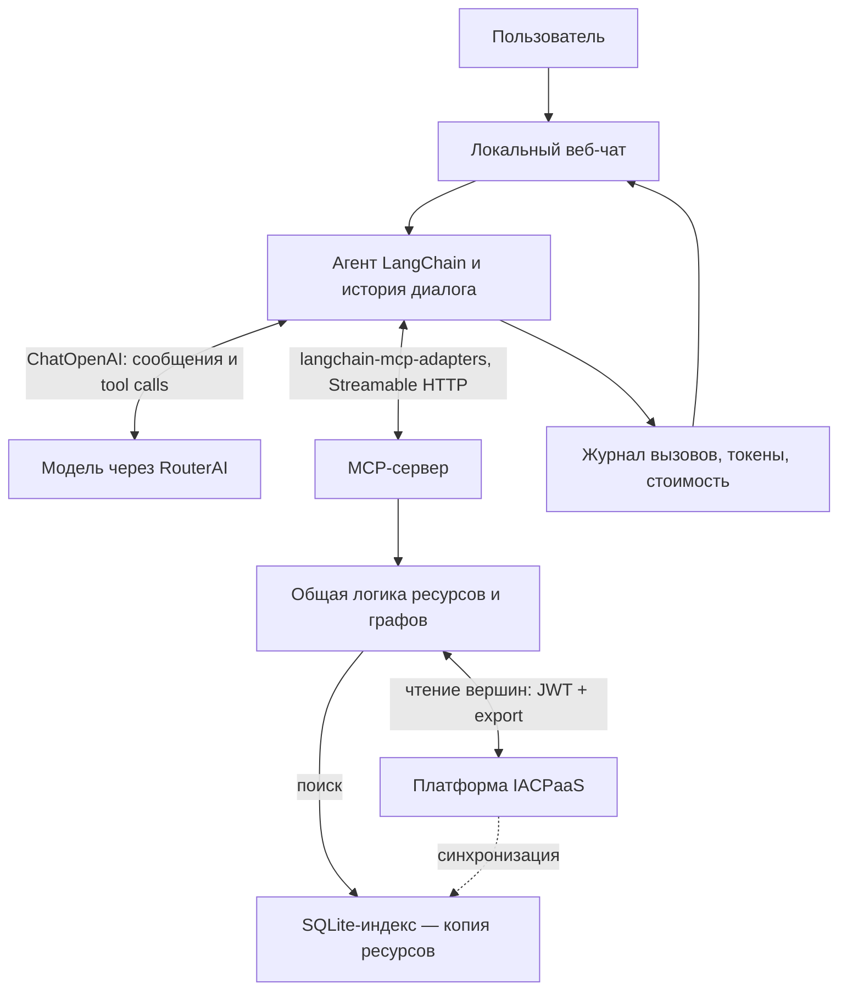

# Архитектура и объяснение проекта

## Задача

Приложение отвечает на вопросы по выбранному набору информационных ресурсов IACPaaS. Оно читает существующие сведения и показывает, какие инструменты использованы для ответа. Новые сведения о материалах не вычисляются, исходные базы не изменяются.

## Как устроены исходные данные

«Материалы и их свойства» — предметная область. Технически она ограничена списком разрешённых ресурсов, у каждого свой путь в «Мой Фонд». Папка «Загрузки» только организует эти ресурсы; отдельной онтологией она не является.

Онтология описывает допустимые понятия, свойства и отношения. База знаний содержит конкретные сведения, описанные по этой структуре. По одной онтологии можно создать разные базы. И онтология, и база представлены графами: вершины описывают понятия и значения, связи соединяют их, ссылки могут вести в другие ресурсы. Формат задаёт [документация JSON IACPaaS](https://iacpaas.dvo.ru/docs/Json/Json.html). Что именно лежит в наших восьми ресурсах — в [docs/data.md](data.md).

При чтении используется формат `universal`: у вершин есть идентификаторы, имена или значения, метки метапонятий и потомки `successors`. Приложение приводит его к компактным вершинам и дугам.

Граница области задаётся разрешёнными путями в `config/resources.json`, а не догадкой модели. Чтобы перейти на другой набор ресурсов, меняют этот файл (и описание `config/data_notes.json`), а затем перестраивают индекс.

## Гибридный доступ к платформе

HTTP API платформы умеет выгружать ресурс целиком или фрагмент от заданной вершины на заданную глубину. Поиска по тексту в нём нет. Поэтому:

- **Поиск** идёт по локальному SQLite-индексу. При синхронизации ресурсы выгружаются с платформы целиком; индекс — их снимок с датой.
- **Чтение** найденной вершины (`get_subgraph`) и метаданных ресурса (`get_inforesource`) идёт **прямо на платформу**. Путь к вершине восстанавливается по индексу: имена от корня, например `/Сплавы на основе железа/12Х18Н10Т`. Если платформа недоступна, ответ берётся из индекса с явной пометкой.

В журнале каждого вызова видно, откуда пришли данные: «IACPaaS», «индекс» или «индекс — платформа недоступна». Подробности и коды ошибок — в [api-mapping.md](api-mapping.md).

Лимиты числа результатов, глубины и размера ответа не дают передать модели весь большой справочник (около 94 тысяч вершин). Усечение всегда помечено: ограниченная выборка не доказывает отсутствия других записей.

## Как работает агент

Агент построен на LangChain (`materials_chat/agent.py`). Функция `create_agent` собирает граф LangGraph из двух узлов: `model` (обращение к модели) и `tools` (выполнение запрошенных инструментов). Переход между ними зависит от того, попросила ли модель инструменты (`tool_calls`). Правила приложения добавлены одним middleware `TurnPolicy`, а стандартный цикл не переписан.

| Часть | Из LangChain | Что добавлено в проекте |
|---|---|---|
| Инструменты | `langchain-mcp-adapters`: `load_mcp_tools` превращает инструменты MCP-сервера (имя, описание, JSON Schema) в инструменты LangChain | Одна MCP-сессия на вопрос (`mcp_client.py`) |
| Модель | `ChatOpenAI` с адресом RouterAI | Подкласс `RouterAIChat` (`openrouter.py`) сохраняет фактическую стоимость `usage.cost` и рассуждения `reasoning_details`, которые стандартный класс отбрасывает |
| Цикл | граф `create_agent`, параллельное выполнение инструментов | `TurnPolicy.awrap_model_call`: `tool_choice="auto"`, на последнем шаге `"none"` и подсказка «ответь по найденному»; проверка размера контекста; учёт расхода |
| Вызов инструмента | узел `tools` | `TurnPolicy.awrap_tool_call`: лимит вызовов, события для интерфейса, журнал, результат в виде JSON-конверта |
| Поток | `astream` с режимами `messages` (текст модели), `custom` (события middleware), `values` (состояние графа) | Перевод в события SSE интерфейса |

Ход одного вопроса:

1. Сервер принимает сообщение и собирает историю диалога. Последние два хода передаются полностью, у более старых результаты инструментов сокращаются. История хранится в формате Chat Completions; `convert_to_messages` превращает её в сообщения LangChain.
2. MCP-клиент открывает сессию и получает описания инструментов (JSON Schema).
3. Модель получает системную инструкцию, историю и инструменты (`tool_choice="auto"`) и **сама решает**, нужны ли данные.
4. Если модель запросила инструменты, узел `tools` выполняет их через MCP (несколько вызовов одного шага — параллельно) и возвращает структурированные результаты. Цикл повторяется.
5. На последнем разрешённом шаге (`MAX_TOOL_STEPS`) или после `MAX_TOOL_CALLS` вызовов инструменты отключаются (`tool_choice="none"`). Модель обязана ответить по уже найденному. Вызовы сверх лимита не выполняются и получают ответ-ошибку `tool_limit`.
6. Текст ответа идёт в интерфейс потоком; после ответа отправляются признак «опирался ли ответ на данные» и расход.

В LangChain есть готовые лимиты, но они ведут себя иначе. `ModelCallLimitMiddleware` при исчерпании лимита завершает агента служебным сообщением или исключением. `ToolCallLimitMiddleware` отвечает ошибкой на лишние вызовы, но оставляет модели инструменты, и она может продолжать их просить. Нам нужен последний запрос с отключёнными инструментами, чтобы модель ответила по найденным данным. Поэтому лимиты реализованы в своём middleware.

Запрет на выдуманные факты обеспечивают промпт, видимые источники и журнал. Ответы без обращения к инструментам (приветствие, вопрос о диалоге, отказ не по теме) не подменяются шаблоном, а помечаются в интерфейсе. Языковая модель остаётся вероятностной: журнал позволяет проверить соответствие ответа данным, а проверочные сценарии выявляют нарушения.

Ошибки провайдера (лимит контекста, ключ, баланс, тайм-аут) доходят до пользователя своим текстом. Внутри MCP-сессии библиотека anyio заворачивает исключения в `ExceptionGroup`, поэтому агент поднимает ошибку уже после выхода из сессии.

## Что показывает интерфейс

- **Диалоги** — список чатов, поток ответа, журнал инструментов (аргументы, результат, длительность, источник данных).
- **Данные** — подготовленное описание выданных ресурсов (`GET /api/data/overview`): классы материалов и число марок, свойства, единицы, онтологии, примеры вопросов; состояние индекса и кнопка обновления.
- **Расход** — токены и стоимость в рублях за ответ и за диалог, оценка заполнения контекста относительно окна модели. Окно и цены берутся из каталога RouterAI, фактическая стоимость — из ответа провайдера.

Контракт между сервером и интерфейсом описан в [http-api.md](http-api.md). Внутренние рассуждения модели не показываются. История чата хранится локально в SQLite, отдельно от контекстных инфоресурсов IACPaaS.

## Политика доступа

Используются выданные ресурсы только для чтения. У модели нет инструментов импорта, обновления или удаления, поэтому подтверждение записи не требуется: самой операции нет. Если запись понадобится, для неё нужны отдельные инструменты и явное подтверждение пользователя.

JWT запрашивается входом в IACPaaS; пароль и ключ RouterAI читаются из локального `.env`. Значения секретов не попадают в результаты инструментов и журнал. Собственной авторизации у веб-чата нет: это локальный учебный экземпляр.

## Соответствие заданию

| Требование | Реализация или согласованная граница |
|---|---|
| MCP-адаптер к фактическому API | Вход и экспорт IACPaaS; чтение вершин напрямую с платформы; сопоставление в api-mapping.md |
| HTTP и stdio | Два транспорта одной общей логики |
| Типизированные аргументы и структурированные результаты | Схемы инструментов, проверки аргументов, диагностируемые ошибки |
| Самостоятельный агент (LangChain/LangGraph) | `create_agent` из LangChain, инструменты через `langchain-mcp-adapters`, RouterAI, веб-интерфейс |
| Трасса вызовов | События инструментов и результаты в чате, сохраняются в истории |
| Чтение и изменение разделены | Только чтение, изменение не предоставлено |
| Интеграция VS Code | Не входит в объём работы по решению автора |
| Демонстрационные сценарии | `docs/scenarios.md`, результаты — `docs/verification.md` |
