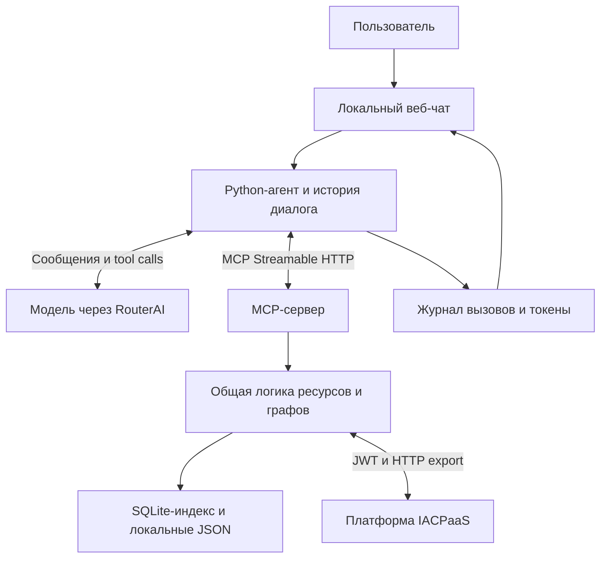

# Архитектура и объяснение проекта

## Задача

Приложение отвечает на вопросы по выбранному набору информационных ресурсов IACPaaS. Оно читает существующие сведения и показывает, какие инструменты использованы для ответа. Новые сведения о материалах не вычисляются, исходные базы не изменяются.

## Как устроены исходные данные

«Материалы и их свойства» — предметная область. Технически область ограничена списком разрешённых ресурсов, каждый со своим путём в «Мой Фонд». Папка «Загрузки» организует эти ресурсы; папка не является отдельной онтологией.

Онтология описывает допустимые понятия, свойства и отношения. База знаний содержит конкретные сведения, описанные по этой структуре. По одной онтологии могут быть созданы разные базы. И онтология, и база представлены графами: вершины описывают понятия и значения, связи соединяют их. Ссылки могут вести в другие ресурсы. Подробности формата задаёт [документация JSON IACPaaS](https://iacpaas.dvo.ru/docs/Json/Json.html).

При чтении используется `universal`: вершины имеют идентификаторы, имена или значения, метки метапонятий и потомков `successors`. Приложение приводит этот формат к компактным вершинам и связям, пригодным для поиска. Полные внутренние записи платформы не включаются в параметры инструментов модели.

Граница области задаётся разрешёнными путями в `config/resources.json`, а не догадкой модели. Чтобы перейти на другой выданный набор ресурсов, меняют этот файл и перестраивают индекс. Локальный идентификатор вроде `materials` — понятный псевдоним для инструмента; это не числовой идентификатор платформы. После смены ресурсов нужно проверить новые поисковые запросы и структуру онтологии: одинаковый JSON-формат не гарантирует одинаковые названия свойств и отношений.

## Зачем нужен индекс

HTTP API платформы умеет экспортировать ресурс или подграф. Готовый HTTP endpoint для полнотекстового поиска по всем вершинам не подтверждён. Поэтому первая загрузка сохраняет JSON ресурса и индексирует его локально; дальнейший лексический поиск работает по этой копии. Это техническое решение адаптера, а не возможность, приписанная API платформы.

У поискового результата есть источник, идентификатор вершины, путь и небольшой фрагмент. Агент может запросить подграф найденной вершины. Лимиты числа результатов, глубины и размера ответа не позволяют передать модели весь большой справочник. Усечение должно быть явно обозначено: ограниченная выборка не является доказательством отсутствия других записей.

Индекс представляет снимок ресурса на момент синхронизации. Время загрузки сохраняется в метаданных. Если платформа изменилась, нужна повторная синхронизация. Возможность ответить по ранее загруженным данным при недоступности сети должна сопровождаться указанием источника и времени снимка; ошибка обновления не означает, что материал отсутствует.

Ссылки в другие ресурсы сохраняются в данных вершины. Они не означают неограниченный переход во весь фонд: нужный связанный ресурс должен присутствовать в разрешённом списке. Подсчёт относится к нормализованному экспортированному графу; он может отличаться от служебного счётчика платформы, если тот учитывает ссылки или вершины иначе.

## Как работает агент

Использован обычный цикл tool calling на Python. Это небольшая альтернатива LangChain/LangGraph: ход работы виден в нескольких функциях, не требуется отдельное обучение модели.

1. Сервер принимает сообщение и добавляет его в историю чата.
2. MCP-клиент получает описания доступных инструментов и их JSON Schema.
3. В модель передаются история, системная инструкция и инструменты.
4. Если модель запросила инструмент, приложение проверяет имя и аргументы и вызывает его через MCP.
5. Структурированный результат возвращается в модель. При необходимости выполняется следующий вызов.
6. Финальный текст и расход токенов отправляются в интерфейс.

Число шагов и объём ответов ограничены, чтобы ошибочная последовательность вызовов не продолжалась бесконечно. Критичные идентификаторы следует брать из результатов поиска; при неоднозначности агент задаёт уточнение.

Запрет на выдуманные факты поддерживается промптом, обязательным получением данных и видимыми источниками. Языковая модель остаётся вероятностной: журнал позволяет проверить соответствие ответа данным, а проверочные сценарии выявляют нарушения. Проект не обещает формальную проверку каждого утверждения на естественном языке.

## Что показывает интерфейс

Журнал — фактические события выполнения: имя инструмента, аргументы, начало, окончание, результат или ошибка. Внутренние рассуждения модели не запрашиваются и не показываются. Результат инструмента ограничен, большие детали можно раскрыть в интерфейсе.

Расход запроса включает входные и выходные токены всех шагов модели. Расход сессии — сумма обращений; он не равен числу токенов в текущем контексте. Размер истории оценивается приблизительно, а usage учитывается по данным провайдера. История чата сохраняется локально в SQLite отдельно от контекстных инфоресурсов IACPaaS.

## Политика доступа

Используются выданные ресурсы только для чтения. У модели нет инструментов импорта, обновления или удаления. Поэтому подтверждение записи в этой версии не требуется: отсутствует сама операция, которую можно было бы подтвердить. Добавление записи в будущем потребует отдельных инструментов и явного подтверждения пользователя, как указано в исходном задании.

JWT запрашивается через вход в IACPaaS; пароль и ключ RouterAI читаются из локального `.env`. Значения секретов не должны появляться в результатах инструментов и журнале. Самостоятельная авторизация пользователей веб-чата не реализована: это локальный учебный экземпляр.

## Соответствие заданию

| Требование | Реализация или согласованная граница |
|---|---|
| MCP-адаптер к фактическому API | HTTP-клиент IACPaaS и документированное сопоставление инструментов |
| HTTP и stdio | Два транспорта одной общей логики |
| Типизированные аргументы и структурированные результаты | Схемы инструментов, проверки аргументов, диагностируемые ошибки |
| Самостоятельный агент | Python tool loop, RouterAI и веб-интерфейс |
| Трасса вызовов | События инструментов и результаты в чате |
| Чтение и изменение разделены | Только чтение, изменение не предоставлено |
| Интеграция VS Code | Исключена по прямому уточнению пользователя |
| Демонстрационные сценарии | Описаны в `docs/scenarios.md`; результаты реального прогона отмечаются отдельно |
