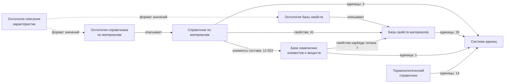

# Данные проекта: что нам выдали и как это устроено

Документ описывает восемь ресурсов IACPaaS, к которым у проекта есть доступ (папка «Мой Фонд / Загрузки», только чтение).
Цифры посчитаны по локальному индексу `data/search.sqlite3` — снимку от 18.10.2026. После обновления из IACPaaS они
могут измениться; актуальные значения показывает вкладка «Данные» (`GET /api/data/overview`), см. раздел 11.

Коротко: **1 334 марки сплавов с химическим составом**, словарь из **28 свойств**, **39 химических элементов**,
**50 единиц измерения**, **31 термин** и три онтологии, по которым часть этого записана. Почти все данные (99 %) —
это справочник по материалам, и почти весь он — химический состав. Свойства (плотность, температура плавления и т. п.)
заполнены только у **7 марок**.

## 1. Восемь ресурсов

| Ресурс | id в проекте | Что это | Вершин | Изменён на платформе |
|---|---|---|---:|---|
| Справочник по материалам | `materials` | марки сплавов по классам и их химический состав | 93 593 | 28.08.2026 |
| База свойств материалов | `properties` | словарь свойств: классы, единицы, синонимы | 230 | 08.10.2026 |
| База химических элементов и веществ | `elements` | элементы (обозначение, номер) и несколько веществ | 153 | 18.10.2026 |
| Система единиц физических величин | `units` | величины, единицы, кратные и дольные единицы | 333 | 19.02.2026 |
| Терминологический справочник | `terms` | термины металлографии и порошков с синонимами | 112 | 16.10.2026 |
| Онтология справочника по материалам | `materials_ontology` | схема записи марки | 101 | 29.01.2026 |
| Онтология базы свойств материалов | `properties_ontology` | схема словаря свойств | 11 | 27.04.2025 |
| Онтология описания характеристик и их значений | `characteristics_ontology` | общие форматы значений | 36 | 23.10.2025 |
| **Всего** | | | **94 569** | |

**База (информационный ресурс)** содержит сами сведения: марки, числа, названия. **Онтология** — схема: какие понятия
бывают и что может быть внутри чего. Например, онтология говорит «у марки есть элементный состав, состав состоит из
компонентов», а база — «у 12Х18Н10Т хрома 17–19 %». И база, и онтология хранятся на платформе как дерево вершин.
У каждой вершины есть имя (или значение) и **метапонятие** — имя понятия онтологии, по которому она создана.
Именно по метапонятиям в проекте считаются сущности (см. раздел 11).

## 2. Как ресурсы связаны между собой

Какая онтология описывает какую базу (поле `ontology` в метаданных ресурса):

| База | Построена по онтологии | Онтология выдана? |
|---|---|---|
| Справочник по материалам | Онтология справочника по материалам | да |
| База свойств материалов | Онтология базы свойств материалов | да |
| База химических элементов и веществ | Онтология базы химических элементов и веществ | **нет** |
| Система единиц физических величин | Онтология системы единиц физических величин | **нет** |
| Терминологический справочник | Онтология терминологического справочника | **нет** |

Сами три выданные онтологии записаны на «Языке ИРУО» — метаязыке платформы. Онтология описания характеристик
не описывает ни одну базу напрямую: две другие онтологии подключают её, когда задают формат значения
(число, интервал, «не более» и т. п.).

Записи баз ссылаются друг на друга (поле `original` у вершины — «это та самая вершина из другого ресурса»):



Онтология справочника по материалам ссылается ещё на три ресурса, которых **нет** в выданном наборе:
«Онтология базы химических элементов и веществ» (элемент состава и структура раздела «Свойства»),
«Онтология терминологического справочника» (термины для описания микроструктуры) и «Онтология базы дефектов металла».
Их содержимое проекту недоступно.

## 3. Справочник по материалам: классы и марки

Марка — вершина с метапонятием «Материал». Всего **1 334 марки**, все названия разные. Классы лежат под корнем;
два класса содержат подкласс.

| Класс | Марок | Основа сплава | Примеры |
|---|---:|---|---|
| Сплавы на основе железа | 1 043 | Fe | 12Х18Н10Т, Ст3сп, 08кп, 10ХСНД |
| Сплавы на основе алюминия | 186 | Al | Д16, АМг3, АК12, В95пч |
| Сплавы на основе титана | 59 | Ti | ВТ1-0, ВТ6, ОТ4, ПТ-3В |
| Сплавы на основе магния | 37 | Mg | МА14, МА20, МЛ5 |
| Бронзы | 6 | Cu | БрО10Ц2, БрАМц9-2 |
| Сплавы на основе олова → Баббиты | 1 | Sn | Б83 |
| Сплавы на основе никеля | 1 | Ni | ПНК 1 |
| Редкоземельные сплавы → Магнитные | 1 | Co | КС25ДЦ |

Основа, записанная в составе, у всех марок совпадает с классом (1 043 раза Fe, 186 — Al и т. д.).

## 4. Как устроена запись марки: 12Х18Н10Т по шагам

1. **Где лежит.** Путь: `Справочник по материалам / Сплавы на основе железа / 12Х18Н10Т`. Вершина марки
   имеет метапонятие «Материал». Вся запись — 74 вершины.
2. **Разделы марки.** У 12Х18Н10Т один раздел — «Элементный состав». Так у 1 327 марок; у остальных семи есть ещё
   раздел «Свойства» (раздел 6). Онтология предусматривает шесть разделов, но остальные четыре нигде не заполнены.
3. **Состав.** Внутри «Элементного состава» — «Основа» (Fe) и десять «Компонентов» с номерами 1–10.
4. **Компонент.** В компоненте лежит вершина «Химический элемент» (например, Cr). Это ссылка на вершину
   «Хром / Cr» в базе химических элементов — поэтому агент может перейти от марки к элементу. Рядом — единица «%».
5. **Значение.** Под элементом — одна из форм записи: «Числовой интервал» (нижняя и верхняя граница), «Не более» (знак ≤
   и число), «Не менее», точное «Числовое значение» или «Расчетное».

```
12Х18Н10Т  <Материал>
└─ Элементный состав
   ├─ 2  <Компонент>
   │  └─ Cr  <Химический элемент → База химических элементов / Хром / Cr>
   │     ├─ %
   │     └─ Числовой интервал
   │        ├─ Нижняя граница → 17.0
   │        └─ Верхняя граница → 19.0
   ├─ 8  <Компонент>
   │  └─ C → % ; Не более → ≤ 0.12
   ├─ … ещё 8 компонентов
   └─ Основа → Fe
```

Состав 12Х18Н10Т целиком:

| № | Элемент | Форма записи | Содержание, % |
|---:|---|---|---|
| 1 | Fe | интервал | 66,7–70,0 |
| 2 | Cr | интервал | 17–19 |
| 3 | Ni | интервал | 9–11 |
| 4 | Mn | не более | ≤ 2,0 |
| 5 | Ti | расчётное | от 5 × C до 0,8 |
| 6 | Si | не более | ≤ 0,8 |
| 7 | Cu | не более | ≤ 0,3 |
| 8 | C | не более | ≤ 0,12 |
| 9 | P | не более | ≤ 0,035 |
| 10 | S | не более | ≤ 0,02 |

Титан здесь — единственный во всей базе случай «расчётного» содержания: нижняя граница записана как коэффициент 5,
умноженный на содержание углерода (C — ссылка на компонент 8 той же марки). Путь до числа «5.0» — 9 уровней от корня,
это максимальная глубина справочника.

**Чего в записи нет:** свойств, стандарта, источника, аналогов, микроструктуры. На вопрос «какая плотность у
12Х18Н10Т» правильный ответ чата — «в доступных ресурсах информация не найдена».

## 5. Химический состав по всем маркам

- **12 826 компонентов**, в среднем 9,6 на марку (медиана 10, от 1 до 17; по 17 у 07ГФБ и 07ГФБ-1).
- **32 разных элемента**. Чаще всего встречаются Fe (в 1 323 марках), Si (1 289), Mn (1 209), C (1 068), P (1 009),
  S (1 007), Ni (995), Cr (994), Cu (923).
- **Формы записи содержания** (по 12 826 компонентам):

| Форма | Сколько | Пример |
|---|---:|---|
| Не более (≤) | 7 137 (55,6 %) | C ≤ 0,12 % |
| Числовой интервал | 5 640 (44,0 %) | Cr 17–19 % |
| Точное значение | 26 | Sm 25 % в КС25ДЦ |
| Не менее (≥) | 6 | Al ≥ 99,5 % в 1050 |
| Расчётное | 1 | Ti от 5 × C в 12Х18Н10Т |
| Без значения (только «%») | 9 | Fe в 08Х14 |
| «Прочее» (прочие примеси) | 6 | Прочее ≤ 0,3 % в ВТ1-0 |
| «Совокупность химических элементов» | 1 | Nb + V + Ti ≤ 0,12 % в «Сталь марки РС категории А» |

- **Содержание основы.** У 1 016 марок основа записана как «не более N %» (например, Fe ≤ 98,58 % у стали 08),
  у 303 — интервалом (Fe 66,7–70,0 % у 12Х18Н10Т), у 9 — без числа. По сути это «остальное», но число не равно
  100 % минус сумма остальных элементов — похоже, оно взято из справочника-источника как есть.

## 6. Свойства и единицы измерения

### База свойств материалов — словарь, а не значения

**6 классов свойств и 28 свойств.** Значений для конкретных марок здесь нет: база задаёт, какие свойства бывают,
в каких единицах и как называются по-другому.

| Класс | Свойств | Свойства |
|---|---:|---|
| Механические | 15 | модуль упругости, пластичность, твёрдость (шкалы HB, HV, HRA, HRB, HRC), твёрдость по Бринеллю, по Виккерсу, по Роквеллу (A, B, C), микротвёрдость, пределы прочности, упругости и текучести, ударная вязкость, временное сопротивление при растяжении, относительное удлинение |
| Физические | 10 | температуры плавления (ликвидус, солидус), кипения, кристаллизации; плотность; теплопроводность; удельная теплоёмкость; коэффициент термического расширения; подкласс «Спектральные свойства» — коэффициенты отражения и поглощения, излучательная способность |
| Технологические | 2 | усадка при затвердевании, температура заливки |
| Эксплуатационные | 1 | износостойкость |
| Химические | 0 | класс пустой |

У свойства могут быть единицы измерения (16 вершин: например, К и °C у температур, кг/м³ и г/см³ у плотности),
синонимы (10 свойств; «Плотность материала», «Теплопроводность», «НВ») и «характеристики» — уточнения свойства
(8: температура ликвидус и солидус; шкалы HB, HV, HRA, HRB, HRC; тип индентора у микротвёрдости).

### Значения свойств есть только у 7 марок

| Марка | Свойства (значения из справочника по материалам) |
|---|---|
| АМг3 | ликвидус 639 °C, солидус 600 °C, кипение 2 518 °C, плотность 2 670 кг/м³, теплопроводность 151 Вт/(м·K), теплоёмкость 880 Дж/(кг·К) |
| АК4-1 (1141) | ликвидус 645 °C, кипение 2 518 °C, плотность 2 770 кг/м³, теплопроводность 146 Вт/(м·K), теплоёмкость 797 Дж/(кг·К) |
| Б83 | твёрдость HB 30, температура заливки 713–733 К, плотность 9,5–10,3 г/см³ |
| ВТ1-0 | температура плавления 1 668 °C |
| МА14 | теплопроводность 117,2 Вт/(м·K) |
| МА20 | теплопроводность 136 Вт/(м·K) |
| Сталь марки РС категории А | раздел «Свойства» есть, но пустой |

Каждое свойство в записи марки — ссылка на свойство в базе свойств, а единица — на базу свойств или систему единиц.

### Система единиц

Величины разделены на три группы: **базовые единицы СИ** (7 величин: длина, масса, время, сила тока, температура,
количество вещества, сила света), **производные** (21: давление, плотность, теплопроводность, мощность…) и
**внесистемные** (12: литр, минута, бар, мм рт. ст., об/мин, %, ‰, ppm…). Всего 40 записей величин, 33 разных
названия: часть величин (время, объём, давление и др.) есть и среди производных, и среди внесистемных.

**50 единиц измерения** с русским и международным обозначением (м — m) и ещё **29 кратных и дольных** с множителем
(километр — 1000, миллиметр — 0,001, мегапаскаль и т. д.). В данных о марках используются °C, К, кг/м³, г/см³,
Вт/(м·K) и Дж/(кг·К); проценты в составах записаны просто строкой «%», без ссылки на систему единиц.

## 7. Химические элементы и вещества

- **39 элементов**, у каждого — обозначение и порядковый номер (Железо — Fe, 26). В составах марок встречаются 32;
  не используются гелий, неон, аргон, криптон, ксенон, хлор и селен.
- **8 веществ**: простые — H₂, O₂, N₂; сложные — вода, углекислый газ, метан, угарный газ, карбид титана (TiC).
- Только у **карбида титана** записаны свойства: температура плавления 3 200 °C, теплопроводность 6,8 Вт/(м·K),
  плотность 4,93 г/см³.

## 8. Терминологический справочник

**7 разделов, 31 термин, 13 синонимов.** Разделы: типовые формы частиц металлических порошков (9 терминов:
сферическая, каплеобразная, угловатая…), типовые формы вторых фаз микроструктур сплавов (8), геометрические
характеристики (7: длина, ширина, диаметр… — с единицами м и мм), формы кристаллических зёрен (3), металлические
порошки (2), металлография (1), лазерные технологии (1: режим генерации излучения — «Непрерывный»).

## 9. Онтологии

### Онтология справочника по материалам (101 вершина)

«Класс материалов» содержит марки («Материал») и вложенные классы. У марки предусмотрено шесть разделов —
сколько раз каждый встречается в справочнике:

| Раздел записи марки | Что в нём по схеме | В базе |
|---|---|---:|
| Элементный состав | основа и компоненты (элемент, совокупность элементов или «прочее») | 1 334 |
| Свойства | классы свойств и свойства со значениями | 7 |
| Микроструктура | размер и форма зёрен, вторые фазы, дефекты, анизотропия, изображения | 0 |
| Аналоги | ссылки на другие марки | 0 |
| Источник | тип (документ, сайт, ручное внесение), адрес, время загрузки | 0 |
| Стандарт (норматив) | название стандарта | 0 |

Внутри состава: «Основа» встречается 1 334 раза, «Компонент» — 12 826. Значение может быть числом, интервалом,
«не более», «не менее», набором чисел, качественным значением или «расчётным» (коэффициент × содержание другого
элемента). Форматы значений схема берёт из онтологии описания характеристик.

### Онтология базы свойств материалов (11 вершин)

Класс свойств → вложенный класс или свойство; у свойства — единица измерения, синонимы, возможные значения
(качественное значение, числовой интервал или число) и характеристики. В базе свойств: «Свойство» — 28 раз,
«Возможные значения» — 28, «единица измерения» — 16, «Синонимы» — 10, «Характеристика» — 8.

### Онтология описания характеристик и их значений (36 вершин)

Вспомогательная схема с тремя видами «Характеристики»: структурная (составная), вариантная и структурная с областями
возможных значений. Задаёт, каким может быть значение: числовой интервал (с единицей или без), «не более», «не менее»,
набор чисел, одно число, качественное значение, изображение, «отсутствие/присутствие». Запись «C ≤ 0,12 %» в составе
стали сделана по этой схеме.

## 10. Странности и ограничения данных

**Полнота**
- Свойства есть только у 7 из 1 334 марок (0,5 %), и у одной из них раздел пустой. Чат не сможет ответить на вопросы
  о плотности, прочности или температуре плавления для остальных марок — данных нет.
- Микроструктура, аналоги, источник и стандарт предусмотрены онтологией, но не заполнены ни у одной марки. Поэтому нельзя
  сказать, из какого стандарта взят состав (исключение — комментарий «ГОСТ 52927-2015» у «Стали марки РС категории А»).
- Классы неравномерны: 78 % марок — стали и сплавы железа; никелевых, оловянных и редкоземельных — по одной марке.
- Класс «Химические свойства» пуст. У 18 из 28 свойств нет вершины «единица измерения»: для спектральных
  (безразмерных) это естественно, а у механических (модуль упругости, пределы прочности и текучести) единица указана
  только в комментарии («МПа ГПа», «кг/мм², кг/см², МПа»).
- Онтологии трёх баз (элементы, единицы, термины) и онтология дефектов металла проекту не выданы.

**Сомнительные и неполные записи**
- Ст1 и 40ХСН2МА: состав — только «Fe ≤ 100 %», то есть фактически пустой. ПНК 1: только Ni без числа.
- 9 компонентов без значения (только «%»): Fe у 08Х14, 10ХСНД, ЮНХ16СР3, 7Х5М4ФГБР и «Стали марки РС категории А»,
  Cu у двух бронз БрАЖНМц8,5-…, Co у КС25ДЦ, Ni у ПНК 1. Обычно это основа сплава («остальное»).
- 26 точных значений вместо интервалов (КС25ДЦ, ЮНХ16СР3, 7Х5М4ФГБР, бронзы БрАЖНМц8,5-…, Fe 97 % у Ст3сп) — это
  номинальный состав, а не допуск.
- У ЮНХ16СР3 и 7Х5М4ФГБР комментарий авторов: «Материала (сплава) с таким названием нет, по-видимому. Он есть в виде
  порошка… Выяснить!»; у 08Х14 в комментарии другое имя — 08Х14МФ.
- Титановый сплав 40 записан как «40(dubl)» — видимо, из-за совпадения имени со сталью 40.
- Б83: плотность 9,5–10,3 г/см³ с пометкой авторов «или 7,4 г/см^3 ??» (для оловянного баббита ближе 7,4);
  твёрдость HB 30 с пометкой «27–32 ??».
- Карбид титана: теплопроводность 6,8 Вт/(м·K) при комментарии «21-30 Вт/(м·K)»; плотность 4,93 г/см³ при
  комментарии «4.505».
- Расхождения отмечены и в комментариях к другим числам: АМг3 — кипение 2 518 °C («в скрипте по моделированию 2543»),
  плотность 2 670 кг/м³ при 100 °C и 2 660 при 20 °C; АК4-1 — плотность 2 770 кг/м³ («2800 (splav-kharkov)»).
- В терминологическом справочнике «Формы кристаллических зерен» — одновременно раздел и термин в разделе
  «Металлография»; «сферическая» и «дендритная» встречаются в двух разделах.

**Технические особенности**
- Числа «Вершин» — это уникальные вершины локального индекса: вершина, на которую ведут несколько путей (например,
  «процент» в двух группах единиц), считается один раз. Служебный счётчик платформы может давать другое число.
- В метаданных ресурсов полный путь содержит логин владельца фонда; в интерфейсе показывается короткий путь из
  `config/resources.json`.

## 11. Откуда эти цифры и как их обновить

Вкладка «Данные» получает описание из `GET /api/data/overview`. Его строит функция
`build_overview(db_path, resources, notes)` из `materials_chat/overview.py` при каждом запросе (около 0,5 с на
полном индексе). Она только читает индекс и ничего не пишет в `data/`.

Что считать сущностью, задано в `config/data_notes.json` (описания, подписи, примеры, вопросы). Код универсальный:
если заменить набор ресурсов и не написать заметки, вкладка покажет верхние уровни дерева с числом вершин, а связи
найдёт по ссылкам. Правила подсчёта:

| Что считаем | Ресурс | Признак (метапонятие вершины) |
|---|---|---|
| Марка | Справочник по материалам | «Материал» |
| Класс и подкласс материалов | Справочник по материалам | «Класс материалов» |
| Элемент в составе марки | Справочник по материалам | «Химический элемент» (разные имена) |
| Свойство / класс свойств | База свойств материалов | «Свойство» / «Класс свойств» |
| Химический элемент / вещество | База химических элементов | «Химический элемент» / «Химическое вещество» |
| Величина / единица / кратная и дольная | Система единиц | «Величина» (разные имена) / «Единица измерения» / «Название» |
| Раздел / термин / синоним | Терминологический справочник | «Раздел» / «Термин» / «синоним» |
| «Сколько раз в базе» для онтологии | база по этой онтологии | пары «понятие-родитель → понятие» |

Чтобы цифры обновились, достаточно нажать «Обновить из IACPaaS»: обзор пересчитается по новому снимку. Тексты описаний
в `config/data_notes.json` при этом не меняются — их стоит перечитать, если на платформе поменялась структура.
